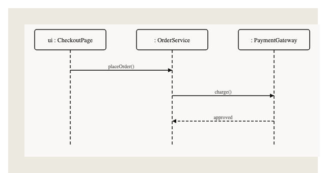
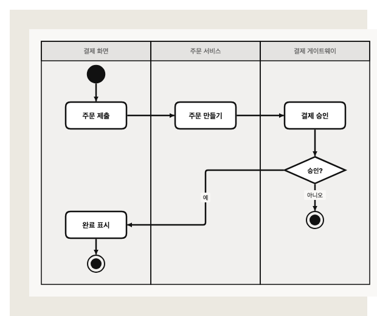
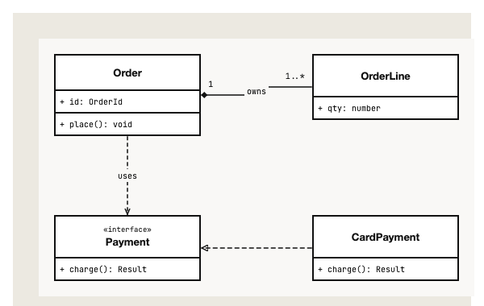
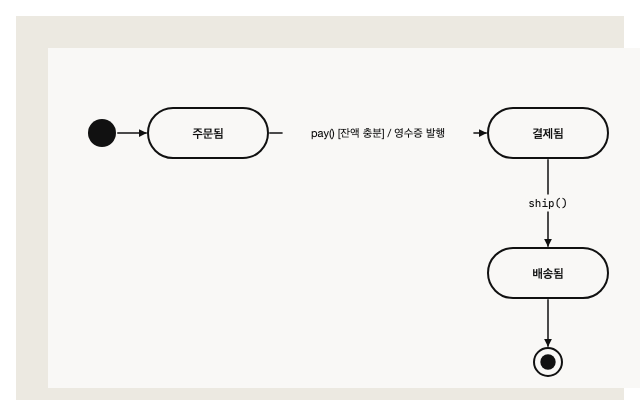

# KAN-082-MD50S0 검토 요청 — viz 도식 스펙 표현력 확장 — 노드 종류·화살표 의미로 가른 여섯 도식과 세 프레임워크, 범례

카드: [KAN-082-MD50S0.md](../cards/KAN-082-MD50S0.md)

> 이 문서는 **검토를 위해 만든 문서**다. 수행 내역은 카드 실행 문서에 있고, 시작 전
> 계획은 배치 문서에 있다. 여기 있는 것은 "지금 이 브랜치를 무엇으로 판정하는가" 뿐이다.

## 1. 검토 대상

| 항목 | 값 |
|---|---|
| 브랜치 | `KAN-082-MD50S0` |
| 워크트리 | `/Users/centurio/orca/workspaces/bbangto-ui/KAN-082-MD50S0` |
| 베이스 | `38be1fa` |
| 변경 훑기 | `git diff 38be1fa...HEAD` |

**커밋 43건**

```text
2a76896 docs(visualization): README 「도식 고르기」 표에 원문의 시간 축 칸 · 부품 표에 LegendBlock (KAN-082 S16)
cf3dd54 fix(storybook): 액티비티 예시 — 노드가 제 스윔레인 안에 들어가게 다시 배치 (KAN-082 S16)
c1a4188 fix(storybook): 시퀀스 예시 — 수명선이 캔버스 밖으로 나가지 않게 lifelineHeight 190 (KAN-082 S16)
3bd78f7 fix(storybook): 상태 머신 예시 — 긴 전이 라벨이 상태 상자와 겹치지 않게 간격을 넓힘 (KAN-082 S16)
ddcf067 docs(visualization): 원문 예시 모음 완성 · README 「도식 고르기」 · 유형 목록 수 맞춤 (KAN-082 S16)
7cc64c7 kanban: KAN-082.5-WPS4DX 검토로 이동 — 검토서(판단 항목 1 · 그림 1) · 카드 문서 + KAN-082 S15 완료
da5a38f feat(visualization): ViewsAndBeyondFrame — SEI Module · C&C · Allocation 세 뷰 조합 프레임 (KAN-082 S15)
64dc999 kanban: KAN-082 묶음 5 끝(태그 batch5) + 묶음 6 착수 시점 판단 + KAN-082.5 진행 중으로
29c9d1c kanban: KAN-082.4-FSH2T1 검토로 이동 — 검토서(판단 항목 2 · 그림 4) · 카드 문서 + KAN-082 S14 완료
dc9bb25 fix(visualization): CommunicationDiagram 세로 링크의 메시지를 링크를 따라 쌓아 글이 겹치지 않게 (KAN-082 S14)
69342ea feat(visualization): CommunicationDiagram — 링크 위 번호 메시지 · 방향, VT-108 별칭으로 등록 + 객체 · 커뮤니케이션 README · 변경셋 (KAN-082 S14)
d369ac0 feat(visualization): ObjectDiagram — 인스턴스 스냅샷(밑줄 이름 · 슬롯 · 링크), VT-101 별칭으로 등록 (KAN-082 S13)
5544e58 feat(visualization): ClassBox 가 빈 칸을 숨긴다 + showEmptyCompartments · nameUnderline (KAN-082 S12, 상류 이슈 P9)
9691081 kanban: KAN-082 묶음 4 끝(태그 batch4) + 묶음 5 착수 시점 판단(객체 상자는 ClassBox 재사용) + KAN-082.4 진행 중으로
92f7f44 kanban: KAN-082.3-TJ665Y 검토로 이동 — 검토서(판단 항목 2 · 그림 3) · 카드 문서 + KAN-082 S11 완료(배포 예시 스토리 간격 넓힘)
7b214c2 kanban: KAN-082 S19 완료 + KAN-082.1 검토서 — 세 항목에 고친 그림 · 결과 의견, 1 · 2항 새로 고침(다시 판정 요청)
a1e7c80 feat(visualization): C4DeploymentDiagram — 배포 노드 중첩 위 컨테이너 인스턴스, VT-104 별칭으로 등록 (KAN-082 S11)
7703008 feat(visualization): 배포 노드 중첩 · 종류 · stereotype · artifact, 토폴로지 링크 라벨, C4 컨테이너 모양 (KAN-082 S10)
575b8ca feat(visualization): Flowchart 선이 fromSide · toSide · waypoints 를 받고 원문 예시에 돌아가는 선 (KAN-082 S19 진행 · .1 검토 3번)
7cbc764 fix(visualization): 마커가 노드 테두리를 넘지 않게 — 시작 마커 방향 · 화살촉 기준점 · 선 끝 간격 · ER 까마귀발 (KAN-082 S18 · .1 검토 2번)
69fdaf2 feat(visualization): 선 라벨이 줄바꿈을 받고 C4 관계선 글을 「설명」 아래 「[기술]」 두 줄로 (KAN-082 S17 · .1 검토 1번)
a6e8328 kanban: KAN-082 실행 계획에 S17~S19(묶음 7) — KAN-082.1 검토 결과 반영(두 줄 라벨 · 화살촉 겹침 QA · 돌아가는 선) + 세 항목에 할 일 의견
eb0b1f6 kanban: KAN-082.1 · .2 검토 제출 반영 — .1 승인 2/3(1번 두 줄 · 3번 fromSide/toSide 고름) · 추가 의견 1(화살촉 겹침 QA), .2 승인 2/2
fa02c65 test(visualization): 배포 노드 중첩 · 종류 · artifact, 토폴로지 링크 라벨, C4 컨테이너 모양, C4DeploymentDiagram 시험 — 구현 전 실패 (KAN-082 S9)
9643f92 kanban: KAN-082 묶음 3 끝(태그 batch3) + 묶음 4 착수 시점 판단 + KAN-082.3 진행 중으로
7d80338 kanban: KAN-082.1 검토서 항목 1 · 3 — 원문 출처를 KANBAN.md 줄 번호 대신 카드 원문 블록으로(보드가 바뀌면 줄이 밀린다)
e6c598e kanban: KAN-082.2-P4970X 검토로 이동 — 검토서(판단 항목 2 · 그림 3) · 카드 문서 + KAN-082 S8 완료
0cab764 feat(visualization): 템플릿 아홉이 관계 종류를 받고 종류가 둘 이상이면 범례를 붙인다 (KAN-082 S8)
b95be06 feat(visualization): 관계 종류 열 가지 · 선 모양 매핑 · LegendBlock 범례 + Class · ER 매핑 export (KAN-082 S7)
e882f87 test(visualization): 관계 종류 목록 · 선 모양 매핑 · 범례 견본 시험 — 구현 전 실패 (KAN-082 S6)
f4f81cf kanban: KAN-082 묶음 2 끝(태그 batch2) + 묶음 3 착수 시점 판단 + KAN-082.2 진행 중으로
362f047 kanban: KAN-082.1-ZFJJM6 검토로 이동 — 검토서(판단 항목 3 · 그림 4) · 카드 문서 + KAN-082 S5 완료
365fb9f feat(visualization): 선 가운데 라벨 위치 보정 칸 labelOffset (KAN-082 S5 · 계획 「만약」 대응)
b2836cf docs(visualization): 원문 예시 DFD · 플로우차트 스토리 + README 라벨 동작 + 변경셋 minor (KAN-082 S5)
c10b361 kanban: KAN-082-MD50S0 보드 자동 줄 — 실행 문서 4/16 (S4 커밋에서 빠뜨림)
88726aa feat(visualization): ClassDiagram 이 stereotype · 관계 이름 · 다중성을 그리고 포함 · 집합의 부분 쪽 화살촉을 뗀다 (KAN-082 S4)
fd8c8e3 kanban: KAN-082-MD50S0 묶음 1 끝(태그 batch1) + 묶음 2 착수 시점 판단(S5 유지 · 마름모는 이미 전체 쪽, 부분 쪽 화살촉만 뗀다)
e588afc feat(visualization): 템플릿 14개가 관계 라벨 · 기술 · 전이 · 분기 라벨을 Edge 로 넘긴다 (KAN-082 S3)
9f44b8e feat(visualization): Edge 가 label 을 선 가운데에 바탕과 함께 그린다 (KAN-082 S2)
7764f48 test(visualization): 템플릿 라벨 계열 칸 렌더 시험 — 구현 전 실패 (KAN-082 S1)
58e5a39 kanban: KAN-082.1-ZFJJM6 진행 중으로 이동 (S1 시작)
10e275c kanban: KAN-082-MD50S0 실행 표시 켬 + 묶음 1 착수 시점 판단(S3 유지, react-dom 이미 있음 · 시험은 *.test.tsx)
f19d20e kanban: KAN-082-MD50S0 진행 중으로 이동 (계획 리포트 버전 1 승인 · 「순차 진행」)
```

**변경 파일 120개 (+19565 −385)**

| 파일 | 상태 | 추가 | 삭제 |
|---|:--:|---:|---:|
| `.changeset/kan-082-deployment.md` | M | 14 | 0 |
| `.changeset/kan-082-edge-labels.md` | M | 16 | 0 |
| `.changeset/kan-082-object-communication.md` | M | 13 | 0 |
| `.changeset/kan-082-relation-kinds.md` | M | 15 | 0 |
| `.changeset/kan-082-views-and-beyond.md` | M | 10 | 0 |
| `.kanban/archive.jsonl` | M | 11 | 0 |
| `.kanban/log.md` | M | 11 | 11 |
| `.kanban/reviews/KAN-082.1-ZFJJM6.events.jsonl` | M | 22 | 0 |
| `.kanban/reviews/KAN-082.1-ZFJJM6.review.json` | M | 21 | 0 |
| `.kanban/reviews/KAN-082.2-P4970X.events.jsonl` | M | 4 | 0 |
| `.kanban/reviews/KAN-082.2-P4970X.review.json` | M | 21 | 0 |
| `.kanban/reviews/KAN-082.3-TJ665Y.events.jsonl` | M | 2 | 0 |
| `.kanban/reviews/KAN-082.3-TJ665Y.review.json` | M | 21 | 0 |
| `.kanban/reviews/KAN-082.4-FSH2T1.events.jsonl` | M | 2 | 0 |
| `.kanban/reviews/KAN-082.4-FSH2T1.review.json` | M | 21 | 0 |
| `.kanban/reviews/KAN-082.5-WPS4DX.events.jsonl` | M | 3 | 0 |
| `.kanban/reviews/KAN-082.5-WPS4DX.review.json` | M | 21 | 0 |
| `.kanban/state.json` | M | 130 | 137 |
| `KANBAN.board.html` | M | 2 | 2 |
| `KANBAN.md` | M | 38 | 28 |
| `KANBAN/batches/KAN-082-MD50S0.batch1.md` | M | 8 | 0 |
| `KANBAN/batches/KAN-082-MD50S0.batch2.md` | M | 7 | 0 |
| `KANBAN/batches/KAN-082-MD50S0.batch3.md` | M | 8 | 0 |
| `KANBAN/batches/KAN-082-MD50S0.batch4.md` | M | 8 | 0 |
| `KANBAN/batches/KAN-082-MD50S0.batch5.md` | M | 6 | 0 |
| `KANBAN/batches/KAN-082-MD50S0.batch6.md` | M | 5 | 0 |
| `KANBAN/batches/KAN-082-MD50S0.batch7.md` | M | 46 | 0 |
| `KANBAN/cards/KAN-082-MD50S0.md` | M | 54 | 15 |
| `KANBAN/cards/KAN-082.1-ZFJJM6.md` | M | 37 | 0 |
| `KANBAN/cards/KAN-082.2-P4970X.md` | M | 33 | 0 |
| `KANBAN/cards/KAN-082.3-TJ665Y.md` | M | 34 | 0 |
| `KANBAN/cards/KAN-082.4-FSH2T1.md` | M | 34 | 0 |
| `KANBAN/cards/KAN-082.5-WPS4DX.md` | M | 29 | 0 |
| `KANBAN/reviews/KAN-082.1-ZFJJM6.assets/1de6fabeaf8c.png` | B | 0 | 0 |
| `KANBAN/reviews/KAN-082.1-ZFJJM6.assets/48d6481c031a.png` | B | 0 | 0 |
| `KANBAN/reviews/KAN-082.1-ZFJJM6.assets/4c04cd899253.png` | B | 0 | 0 |
| `KANBAN/reviews/KAN-082.1-ZFJJM6.assets/86e0fdaf0bd7.png` | B | 0 | 0 |
| `KANBAN/reviews/KAN-082.1-ZFJJM6.assets/900517c06ecf.png` | B | 0 | 0 |
| `KANBAN/reviews/KAN-082.1-ZFJJM6.assets/933032cfeed2.png` | B | 0 | 0 |
| `KANBAN/reviews/KAN-082.1-ZFJJM6.assets/b4e62c8f0b57.png` | B | 0 | 0 |
| `KANBAN/reviews/KAN-082.1-ZFJJM6.assets/e693f4cc72bf.png` | B | 0 | 0 |
| `KANBAN/reviews/KAN-082.1-ZFJJM6.review.html` | M | 2697 | 0 |
| `KANBAN/reviews/KAN-082.1-ZFJJM6.review.md` | M | 350 | 0 |
| `KANBAN/reviews/KAN-082.2-P4970X.assets/2435c7d72ee6.png` | B | 0 | 0 |
| `KANBAN/reviews/KAN-082.2-P4970X.assets/9f7a22e84953.png` | B | 0 | 0 |
| `KANBAN/reviews/KAN-082.2-P4970X.assets/d79b4270f56d.narrow.png` | B | 0 | 0 |
| `KANBAN/reviews/KAN-082.2-P4970X.assets/d79b4270f56d.png` | B | 0 | 0 |
| `KANBAN/reviews/KAN-082.2-P4970X.review.html` | M | 2669 | 0 |
| `KANBAN/reviews/KAN-082.2-P4970X.review.md` | M | 238 | 0 |
| `KANBAN/reviews/KAN-082.3-TJ665Y.assets/841e52dfbab6.png` | B | 0 | 0 |
| `KANBAN/reviews/KAN-082.3-TJ665Y.assets/afb83242195b.png` | B | 0 | 0 |
| `KANBAN/reviews/KAN-082.3-TJ665Y.assets/bd0b7014080f.png` | B | 0 | 0 |
| `KANBAN/reviews/KAN-082.3-TJ665Y.review.html` | M | 2682 | 0 |
| `KANBAN/reviews/KAN-082.3-TJ665Y.review.md` | M | 257 | 0 |
| `KANBAN/reviews/KAN-082.4-FSH2T1.assets/2e2433c36c0d.png` | B | 0 | 0 |
| `KANBAN/reviews/KAN-082.4-FSH2T1.assets/397096bb475e.png` | B | 0 | 0 |
| `KANBAN/reviews/KAN-082.4-FSH2T1.assets/b6f9c23da4d4.png` | B | 0 | 0 |
| `KANBAN/reviews/KAN-082.4-FSH2T1.assets/d2c4b5f08c97.png` | B | 0 | 0 |
| `KANBAN/reviews/KAN-082.4-FSH2T1.review.html` | M | 2680 | 0 |
| `KANBAN/reviews/KAN-082.4-FSH2T1.review.md` | M | 243 | 0 |
| `KANBAN/reviews/KAN-082.5-WPS4DX.assets/05d1a312c560.png` | B | 0 | 0 |
| `KANBAN/reviews/KAN-082.5-WPS4DX.review.html` | M | 2671 | 0 |
| `KANBAN/reviews/KAN-082.5-WPS4DX.review.md` | M | 194 | 0 |
| `apps/storybook/src/stories/ExtendWhenMissing.stories.tsx` | M | 4 | 0 |
| `apps/storybook/src/stories/visualization/Atoms.stories.tsx` | M | 77 | 0 |
| `apps/storybook/src/stories/visualization/DiagramExamples.stories.tsx` | M | 513 | 0 |
| `apps/storybook/src/stories/visualization/G3Templates.stories.tsx` | M | 135 | 2 |
| `apps/storybook/src/stories/visualization/G6MetaFrames.stories.tsx` | M | 55 | 0 |
| `apps/storybook/src/stories/visualization/Molecules.stories.tsx` | M | 38 | 0 |
| `apps/storybook/src/stories/visualization/TemplateDashGate.stories.tsx` | M | 2 | 0 |
| `apps/storybook/src/stories/visualization/_paintGateFixtures.tsx` | M | 79 | 0 |
| `packages/foundations/src/vizPaintGateCoverage.test.ts` | M | 2 | 2 |
| `packages/visualization/README.md` | M | 57 | 1 |
| `packages/visualization/src/atoms/Edge.tsx` | M | 62 | 6 |
| `packages/visualization/src/atoms/EdgeLabel.tsx` | M | 40 | 7 |
| `packages/visualization/src/atoms/Marker.test.tsx` | M | 127 | 0 |
| `packages/visualization/src/atoms/Marker.tsx` | M | 23 | 23 |
| `packages/visualization/src/atoms/index.ts` | M | 13 | 2 |
| `packages/visualization/src/atoms/relationKind.test.tsx` | M | 190 | 0 |
| `packages/visualization/src/atoms/relationKind.ts` | M | 152 | 0 |
| `packages/visualization/src/geometry/routing.test.ts` | M | 199 | 1 |
| `packages/visualization/src/geometry/routing.ts` | M | 85 | 0 |
| `packages/visualization/src/molecules/ClassBox.test.tsx` | M | 63 | 0 |
| `packages/visualization/src/molecules/ClassBox.tsx` | M | 24 | 12 |
| `packages/visualization/src/molecules/LegendBlock.tsx` | M | 139 | 0 |
| `packages/visualization/src/molecules/index.ts` | M | 2 | 0 |
| `packages/visualization/src/templates/ArchitectureDiagram.tsx` | M | 18 | 4 |
| `packages/visualization/src/templates/BPMNCollaborationDiagram.tsx` | M | 6 | 4 |
| `packages/visualization/src/templates/BPMNDiagram.tsx` | M | 4 | 2 |
| `packages/visualization/src/templates/BlockDiagram.tsx` | M | 4 | 1 |
| `packages/visualization/src/templates/C4CodeDiagram.tsx` | M | 20 | 3 |
| `packages/visualization/src/templates/C4ComponentDiagram.tsx` | M | 11 | 3 |
| `packages/visualization/src/templates/C4ContainerDiagram.tsx` | M | 25 | 15 |
| `packages/visualization/src/templates/C4ContextDiagram.tsx` | M | 11 | 3 |
| `packages/visualization/src/templates/C4DeploymentDiagram.tsx` | M | 171 | 0 |
| `packages/visualization/src/templates/C4SystemLandscapeDiagram.tsx` | M | 14 | 2 |
| `packages/visualization/src/templates/ClassDiagram.tsx` | M | 12 | 28 |
| `packages/visualization/src/templates/CommunicationDiagram.tsx` | M | 180 | 0 |
| `packages/visualization/src/templates/ERDiagram.tsx` | M | 9 | 15 |
| `packages/visualization/src/templates/Flowchart.tsx` | M | 16 | 1 |
| `packages/visualization/src/templates/NetworkTopology.tsx` | M | 24 | 3 |
| `packages/visualization/src/templates/ObjectDiagram.tsx` | M | 129 | 0 |
| `packages/visualization/src/templates/StateDiagram.tsx` | M | 4 | 2 |
| `packages/visualization/src/templates/UMLComponentDiagram.tsx` | M | 18 | 4 |
| `packages/visualization/src/templates/UMLDeploymentDiagram.tsx` | M | 112 | 21 |
| `packages/visualization/src/templates/ViewsAndBeyondFrame.tsx` | M | 140 | 0 |
| `packages/visualization/src/templates/c4Types.ts` | M | 26 | 0 |
| `packages/visualization/src/templates/communicationDiagram.test.tsx` | M | 84 | 0 |
| `packages/visualization/src/templates/deployment.test.tsx` | M | 147 | 0 |
| `packages/visualization/src/templates/edgeLabels.test.tsx` | M | 709 | 0 |
| `packages/visualization/src/templates/flowchart.test.tsx` | M | 56 | 0 |
| `packages/visualization/src/templates/index.ts` | M | 13 | 4 |
| `packages/visualization/src/templates/objectDiagram.test.tsx` | M | 56 | 0 |
| `packages/visualization/src/templates/viewsAndBeyond.test.tsx` | M | 46 | 0 |
| `packages/visualization/src/typeMeta/jsdoc.test.ts` | M | 2 | 1 |
| `packages/visualization/src/typeMeta/registry.test.ts` | M | 7 | 7 |
| `packages/visualization/src/typeMeta/registry.ts` | M | 6 | 3 |
| `packages/visualization/type.manifest.json` | M | 3 | 3 |
| `packages/visualization/visualization-type-inventory.md` | M | 10 | 5 |
| `packages/visualization/vitest.config.ts` | M | 3 | 2 |

**롤백 태그 24개**

```text
kan/KAN-082-MD50S0/S1
kan/KAN-082-MD50S0/S10
kan/KAN-082-MD50S0/S11
kan/KAN-082-MD50S0/S12
kan/KAN-082-MD50S0/S13
kan/KAN-082-MD50S0/S14
kan/KAN-082-MD50S0/S15
kan/KAN-082-MD50S0/S17
kan/KAN-082-MD50S0/S18
kan/KAN-082-MD50S0/S19
kan/KAN-082-MD50S0/S2
kan/KAN-082-MD50S0/S3
kan/KAN-082-MD50S0/S4
kan/KAN-082-MD50S0/S5
kan/KAN-082-MD50S0/S6
kan/KAN-082-MD50S0/S7
kan/KAN-082-MD50S0/S8
kan/KAN-082-MD50S0/S9
kan/KAN-082-MD50S0/batch1
kan/KAN-082-MD50S0/batch2
kan/KAN-082-MD50S0/batch3
kan/KAN-082-MD50S0/batch4
kan/KAN-082-MD50S0/batch5
kan/KAN-082-MD50S0/batch7
```

## 2. 검증 — 기준과 실행 결과

<!-- 기준은 카드 실행 문서 「검증」 절의 사본이다. 원본은 KANBAN/cards/KAN-082-MD50S0.md 이므로
     기준이 바뀌면 그쪽을 고치고 review-init --refresh 로 이 항만 다시 만든다.
     결과는 작업한 쪽이 이미 돌린 것이다 — 검토자에게 다시 돌리라고 시키지 않는다.
     **다시 돌려 아래와 다르게 나오면 그 자체가 반려할 이유다.** -->

**기준**

- 원문 예시 스토리: 원문 표의 도식 여섯과 헷갈리는 쌍 셋(「주문 정보가 결제 처리로 간다」 DFD · 「결제 성공이면 배송, 실패면 재시도」 플로우차트 · 「EC2 하나에 API 서버와 워커」를 배포 도식 상자 하나와 런타임 도식 상자 둘로)을 스토리로 그리고, play 함수가 라벨·범례·중첩이 보이는지 확인한다.
- 선언 필드 렌더 검사(vitest): 템플릿 데이터 형식의 라벨 계열 필드(label·technology·fromLabel·toLabel·stereotype)에 찾을 문자열을 넣어 렌더하고, 결과에 모두 나오는지 템플릿 전부에서 본다. 하나라도 빠지면 실패한다.
- 품질 게이트 다섯이 초록이다: `pnpm typecheck` · `pnpm build` · `pnpm test` · `pnpm --filter storybook build` · `pnpm test:unit`.
- 유형 목록 §6 역방향 표·§7 카운트와 `type.manifest.json` 이 새 export(C4 Deployment · ObjectDiagram · CommunicationDiagram · ViewsAndBeyondFrame · 범례 부품)를 담는다.
- 하위마다 `QUALITY_CHECKLIST.md` 의 해당 절을 그 하위 마무리 단계의 커밋 메시지에 붙이고, 그 하위의 검토서 2항에 게이트 실행 결과를 싣는다.

**실행 결과**

```text
게이트 다섯 (2026-11-25, 워크트리 KAN-082-MD50S0, 커밋 cf3dd54 시점)
pnpm typecheck → rc=0 · pnpm build → rc=0(번들 23) · pnpm test → rc=0 · Test Files 199 · Tests 1329
pnpm --filter storybook build → rc=0 · pnpm test:unit → rc=0 · visualization 471 · foundations 143 · hooks 115 · style-guide-catalog 116 · viz catalog 85
그 뒤 README 만 고친 커밋 2a76896 에서 pnpm test:unit 다시 → rc=0(같은 수)
gen:type-manifest · gen:type-jsdoc 다시 돌림 → 바뀐 파일 없음(type.manifest.json · JSDoc 이 registry 와 같다)
a11y: DiagramExamples 를 test:'error' 로 임시 강제 → 위반 0 · 예시 play 에 겹침 검사 셋(상태 라벨 ↔ 상태 상자 · 수명선 끝 ≤ 캔버스 · 액티비티 노드 ⊂ 스윔레인)
범위: base 38be1fa = 지금 main 과 이 브랜치의 갈림점 — 그 뒤 커밋 43건은 모두 이 카드 것(커밋 글에 「KAN-082 S<n>」 · 하위 id 로 적음)
카드 scope 밖 코드 변경 둘 — packages/foundations/src/vizPaintGateCoverage.test.ts(Paint Gate 표본 수 기대값 68→72), packages/visualization/vitest.config.ts(.test.tsx 를 시험 대상에 넣음). 나머지 scope 밖 파일은 이 카드의 칸반 기록 · 검토서 그림이다. scope 는 KAN-080 직렬 중재가 기대는 값이라 고치지 않았다
```

## 3. 판단 항목 — 스크립트가 판정할 수 없는 것

<!-- 스크립트가 판정할 수 없는 것만 적는다 — 값의 진위, 선택지 중 하나를 고른 근거,
     범위를 정한 기준. 2항에서 이미 돌아간 검증을 여기 옮겨 적지 않는다.
     한 줄 형식: 체크박스 하나에 의견 하나 — "<주제> — <지금 고른 값과 그 근거>".
     **의견마다 상세가 따라붙고, 상세는 조각 둘이다** — `**배경**` 과 `**정할 것**` 이
     각각 단독 줄이다(없거나 하나뿐이면 종료코드 12). 검토자는 이 카드를 수행하지
     않았으므로 내부 기호(`L10`·`P5`·`S8`)만 던지면 판정할 재료가 없고, 재료가 있어도
     줄글 한 덩이면 필요한 부분만 골라 읽지 못한다.
       **보기** — 그림이 설명보다 먼저다. `- 종류: 동작|설계|결과물` 과 `- `, 그릴 것이
         없으면 `- 종류: 없음 — <이유>`. 그림은 `review-attach` 로 붙인다(SKILL.md 5.6).
       **배경** — 무엇이 문제인가. `- ` 목록으로, 항목 하나에 사실 하나. 기호를 풀어 쓰고
         항목 끝에 `원문: 파일:줄` 이나 링크를 건다. ①②… 로 늘어놓을 것은 항목으로 가른다.
         목록이 없으면 종료코드 12 — 줄글은 화면에서 한 문단으로 붙는다.
       **정할 것** — 정할 것 한 줄. 그 아래 갈래마다 대가와 결과를 표로 단다:
         | 선택지 | 대가 | 그러면 어떻게 되는가 |
       추천은 선택지 셀 맨 앞의 `**추천** ` 접두다. 「~가 맞는가」로만 묻더라도 아니라고 답할 때
         갈 길(고친다 · 뺀다 · 미룬다)이 있으면 그 길을 갈래로 적는다 — 화면에서 표 없는 항목은
         「승인」 · 「직접 적기」 둘뿐이다. 정말 동의만 구하는 항목이면 표를 비운다.
     **말투와 낱말(SKILL.md 5.10).** 주제 · 배경 · 정할 것은 존댓말(합쇼체 — 「~합니다」 ·
     「~할까요?」)로 쓰고, 이 스킬 안에서만 통하는 낱말과 잘 쓰이지 않는 한자어를 쓰지 않는다 — 목록은 manage-kanban 의
     assets/writing/words.md 이고, 쓰면 경고가 뜬다. 여러 낱말로 된 약속된 용어(「기획 결정」 등)는
     「」로 감싸 앞뒤 글과 구분한다.
     **올리기 전에 둘을 본다.** ① 이 의견이 카드 의도(원문·목적·이유·목표)와 이어지는가
     — 이어지지 않으면 올리지 않는다. 문제를 위한 문제는 판단 항목이 아니라 별도 카드다.
     ② 지시 원본보다 낮은 레이어로 내려가지 않았는가 — 유저가 제품 관점으로 지시했는데
     플래그 이름·함수 이름을 묻고 있으면 서술을 고칠 것이 아니라 올릴 것이 아니다.
     (SKILL.md 5.6 「판단 항목에 무엇을 올리는가」)
     비어 있으면 "기계가 다 판정했고 사람이 정할 것이 없다"는 뜻이다. 그 판단도
     작업한 쪽이 하는 것이지 검토자가 빈칸을 보고 추측할 일이 아니다.
     **넘겨받은 절(3-0, `--inherit`)이 있으면 그것이 먼저 온다** — 다른 검토서에서 넘어온 의견이고,
     판정은 그것을 넘겨받은 이 문서 하나에서만 내려진다. -->

**의견마다 선택지를 고르거나 추가 의견을 답니다.** 「정할 것」 표가 있으면 선택지 하나를 고르고, 표가 없으면
그 의견을 승인합니다. 고른 순간 그 항목은 승인이고, 마음에 드는 선택지가 없으면 추가 의견을 적습니다 —
그 항목은 열린 채 남습니다. 의견 하나만 먼저 고를 수도 있습니다. 검토 화면에서는 「제출」 한 번으로 보냅니다.
`<번호>`는 의견 순서이고, 주제의 문구 일부로도 찾습니다.

```
# 고르기 — 갈래 번호(1부터)나 이름. 표가 없는 항목은 --choice 없이(그 의견의 승인)
python3 scripts/kanban.py review-choose <project-root> --card KAN-082-MD50S0 --item <번호> --choice <번호|이름>
# 추가 의견
python3 scripts/kanban.py review-note <project-root> --card KAN-082-MD50S0 --item <번호> --text "<추가 의견>"
# 반려 · 철회 — 화면에는 없고 명령에만 있습니다
python3 scripts/kanban.py review-judge <project-root> --card KAN-082-MD50S0 --item <번호> --verdict 반려|철회
# 추가 의견을 반영하다 새 의견이 생겼으면 (맨 뒤에 붙어 앞 번호가 안 밀립니다)
python3 scripts/kanban.py review-item <project-root> --card KAN-082-MD50S0 --add "<주제>
  <상세>"
```

**전체 승인은 살아있는 항목이 전부 승인일 때만 섭니다**(철회는 분모에서 빠집니다). 하나라도
반려·추가 의견·미정이면 4항의 전체 승인도 `→ 완료` 이동도 종료코드 14로 거부됩니다.

- [ ] 「도식 고르기」 표에 원문 표준 명칭 밖의 템플릿 넷을 함께 적었는데 이대로 둘까요 — 이미 있는 템플릿을 한 표에서 찾게 하려는 것입니다
    - **보기**
      - 종류: 동작
      - 
      - 
      - 
      - 
    - **배경**
      - 원문은 도식 여섯을 노드 · 화살표의 뜻 · 시간 축으로 나누고 표준 명칭을 붙입니다. 원문: KANBAN.md 의 KAN-082-MD50S0 카드 원문 블록
      - README 「도식 고르기」 표는 그 여섯 줄을 시간 축 칸까지 옮기고, 줄마다 이 패키지의 템플릿을 붙였습니다. 원문: packages/visualization/README.md:58
      - C4(Context · Container · Component · Code 네 단계로 줌인하는 도식 모델)의 템플릿 이름은 그 단계를 따릅니다. 원문 표준 명칭과 바로 맞지 않는 템플릿 넷을 함께 적었습니다. 런타임 줄의 UMLComponentDiagram(C&C, 곧 실행 단위와 연결을 그리는 뷰로 씀)과 ArchitectureDiagram, 코드 구조 줄의 C4CodeDiagram, 동작 줄의 C4DynamicDiagram 입니다.
      - 예시는 Storybook 「Diagram Examples」 한 파일에 모았습니다. 원문의 여섯 도식과 헷갈리는 쌍 셋(DFD vs 플로우차트 · 시퀀스 vs 액티비티 · 배포 vs 런타임)이 다 들어 있습니다. 원문: apps/storybook/src/stories/visualization/DiagramExamples.stories.tsx:380
      - 하위 검토서 다섯의 지금 상태입니다. KAN-082.2 는 항목 둘이 모두 승인이고 문서 전체 승인만 남았습니다. KAN-082.1 은 지적을 고친 뒤 항목 셋이 다시 판정을 기다리고, KAN-082.3 · .4 · .5 는 판정을 기다립니다. main 병합은 하위 판정이 끝난 뒤의 일입니다.
    - **정할 것**
      「도식 고르기」 표의 템플릿 칸을 어떻게 둘까요?

    | 선택지 | 대가 | 그러면 어떻게 되는가 |
    | --- | --- | --- |
    | **추천** 넷을 그대로 둔다 | 원문 표준 명칭과 한 칸씩 맞지 않는 템플릿이 섞입니다 | 원문 분류로 도식을 고른 뒤, 이 패키지에서 쓸 수 있는 템플릿을 한 표에서 모두 찾습니다 |
    | 원문 표준 명칭에 맞는 템플릿만 남긴다 | 넷은 표에서 빠지고 유형 축 질의(selectVizTypes)로만 찾습니다 | 표가 원문과 한 칸씩 맞습니다 |

    > **판정** — _아직 없습니다._

    > **추가 의견** — _아직 없습니다._


## 4. 판정

<!-- 문서 하나에 대한 판정이다. **항목별로 갈리는 말은 여기 적지 않는다** — 3항 각 의견의
     「판정」과 「추가 의견」에 적는다. 여기 남는 것은 그 항목들이 전부 승인으로 닫혔다는
     사실 하나뿐이다.
     아래 「판정 이력」은 **덧붙기만 하는 이력**이다. 왕복이 돌면 줄이 쌓이고, 그것이 이 문서가
     무엇을 거쳐 승인에 닿았는지의 전부다 — 지우지 않는다. **판정에는 이유를 적는 칸이 없다** —
     승인은 대체로 덧붙일 말이 없고, 있다면 그것은 문서 전체가 아니라 그 항목에 대한
     말이라 3항의 「추가 의견」이 받는다.
     `review-judge --card KAN-082-MD50S0 --verdict 승인` 이 이 판정을 적고
     frontmatter 의 status 도 함께 고친다. 손으로 적어도 되지만, 그때는 수렴 검사를
     안 거치므로 `validate` 가 항목 판정과 어긋난 승인을 error 로 잡는다. -->

**판정**: (아직 없습니다)

**판정 이력**:

- 승인이면 → `apply --op move --id KAN-082-MD50S0 --to done` 뒤에 `main` 병합과 워크트리 정리(출력의 `cleanup`)
- 반려면 → `apply --op move --id KAN-082-MD50S0 --to doing` 뒤에 `doc-log --entry "<반려 이유>"`.
  검토서는 **지우지도 새로 만들지도 않습니다** — 고친 뒤 그 항목을 `review-judge --verdict 승인` 으로
  바꾸면 같은 문서에서 모든 항목이 승인될 때까지 이어 갑니다. 1·2항이 최신이 아니면 `review-init --refresh` 로 그 두 항만 새로 씁니다.
