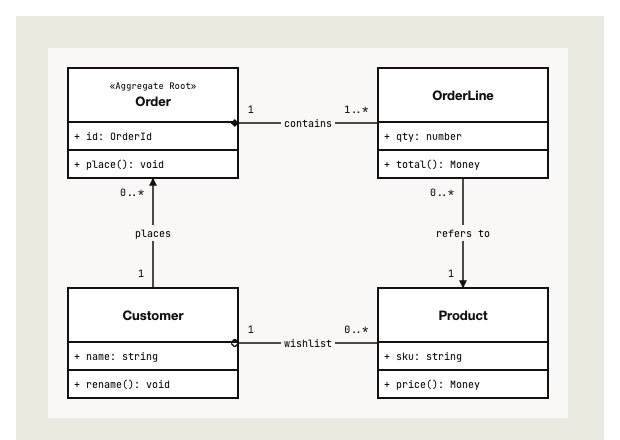
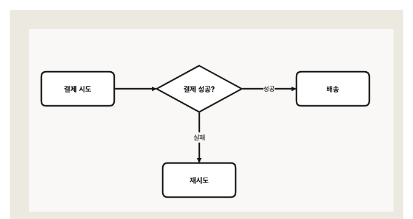
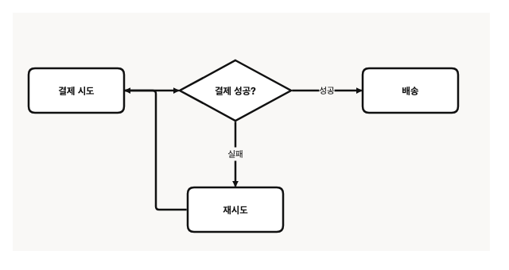

# KAN-082.1-ZFJJM6 검토 요청 — viz 템플릿 간선 라벨·선언 필드 렌더 복구 — 받고도 안 그리는 label·technology·다중성·stereotype

카드: [KAN-082.1-ZFJJM6.md](../cards/KAN-082.1-ZFJJM6.md)

> 이 문서는 **검토를 위해 만든 문서**다. 수행 내역은 카드 실행 문서에 있고, 시작 전
> 계획은 배치 문서에 있다. 여기 있는 것은 "지금 이 브랜치를 무엇으로 판정하는가" 뿐이다.

## 1. 검토 대상

| 항목 | 값 |
|---|---|
| 브랜치 | `KAN-082-MD50S0` |
| 워크트리 | `/Users/centurio/orca/workspaces/bbangto-ui/KAN-082-MD50S0` |
| 베이스 | `38be1fa` |
| 변경 훑기 | `git diff 38be1fa...HEAD` |

**커밋 11건**

```text
365fb9f feat(visualization): 선 가운데 라벨 위치 보정 칸 labelOffset (KAN-082 S5 · 계획 「만약」 대응)
b2836cf docs(visualization): 원문 예시 DFD · 플로우차트 스토리 + README 라벨 동작 + 변경셋 minor (KAN-082 S5)
c10b361 kanban: KAN-082-MD50S0 보드 자동 줄 — 실행 문서 4/16 (S4 커밋에서 빠뜨림)
88726aa feat(visualization): ClassDiagram 이 stereotype · 관계 이름 · 다중성을 그리고 포함 · 집합의 부분 쪽 화살촉을 뗀다 (KAN-082 S4)
fd8c8e3 kanban: KAN-082-MD50S0 묶음 1 끝(태그 batch1) + 묶음 2 착수 시점 판단(S5 유지 · 마름모는 이미 전체 쪽, 부분 쪽 화살촉만 뗀다)
e588afc feat(visualization): 템플릿 14개가 관계 라벨 · 기술 · 전이 · 분기 라벨을 Edge 로 넘긴다 (KAN-082 S3)
9f44b8e feat(visualization): Edge 가 label 을 선 가운데에 바탕과 함께 그린다 (KAN-082 S2)
7764f48 test(visualization): 템플릿 라벨 계열 칸 렌더 시험 — 구현 전 실패 (KAN-082 S1)
58e5a39 kanban: KAN-082.1-ZFJJM6 진행 중으로 이동 (S1 시작)
10e275c kanban: KAN-082-MD50S0 실행 표시 켬 + 묶음 1 착수 시점 판단(S3 유지, react-dom 이미 있음 · 시험은 *.test.tsx)
f19d20e kanban: KAN-082-MD50S0 진행 중으로 이동 (계획 리포트 버전 1 승인 · 「순차 진행」)
```

**변경 파일 37개 (+1442 −118)**

| 파일 | 상태 | 추가 | 삭제 |
|---|:--:|---:|---:|
| `.changeset/kan-082-edge-labels.md` | M | 14 | 0 |
| `.kanban/archive.jsonl` | M | 2 | 0 |
| `.kanban/log.md` | M | 2 | 2 |
| `.kanban/state.json` | M | 28 | 28 |
| `KANBAN.board.html` | M | 2 | 2 |
| `KANBAN.md` | M | 46 | 46 |
| `KANBAN/batches/KAN-082-MD50S0.batch1.md` | M | 8 | 0 |
| `KANBAN/batches/KAN-082-MD50S0.batch2.md` | M | 7 | 0 |
| `KANBAN/cards/KAN-082-MD50S0.md` | M | 15 | 5 |
| `apps/storybook/src/stories/ExtendWhenMissing.stories.tsx` | M | 4 | 0 |
| `apps/storybook/src/stories/visualization/Atoms.stories.tsx` | M | 77 | 0 |
| `apps/storybook/src/stories/visualization/DiagramExamples.stories.tsx` | M | 121 | 0 |
| `apps/storybook/src/stories/visualization/G3Templates.stories.tsx` | M | 90 | 0 |
| `packages/visualization/README.md` | M | 11 | 0 |
| `packages/visualization/src/atoms/Edge.tsx` | M | 52 | 3 |
| `packages/visualization/src/atoms/EdgeLabel.tsx` | M | 9 | 2 |
| `packages/visualization/src/atoms/index.ts` | M | 2 | 2 |
| `packages/visualization/src/geometry/routing.test.ts` | M | 199 | 1 |
| `packages/visualization/src/geometry/routing.ts` | M | 85 | 0 |
| `packages/visualization/src/templates/ArchitectureDiagram.tsx` | M | 4 | 2 |
| `packages/visualization/src/templates/BPMNCollaborationDiagram.tsx` | M | 6 | 4 |
| `packages/visualization/src/templates/BPMNDiagram.tsx` | M | 4 | 2 |
| `packages/visualization/src/templates/BlockDiagram.tsx` | M | 4 | 1 |
| `packages/visualization/src/templates/C4CodeDiagram.tsx` | M | 10 | 1 |
| `packages/visualization/src/templates/C4ComponentDiagram.tsx` | M | 2 | 1 |
| `packages/visualization/src/templates/C4ContainerDiagram.tsx` | M | 2 | 1 |
| `packages/visualization/src/templates/C4ContextDiagram.tsx` | M | 2 | 1 |
| `packages/visualization/src/templates/C4SystemLandscapeDiagram.tsx` | M | 5 | 1 |
| `packages/visualization/src/templates/ClassDiagram.tsx` | M | 12 | 3 |
| `packages/visualization/src/templates/ERDiagram.tsx` | M | 4 | 1 |
| `packages/visualization/src/templates/Flowchart.tsx` | M | 4 | 1 |
| `packages/visualization/src/templates/StateDiagram.tsx` | M | 4 | 2 |
| `packages/visualization/src/templates/UMLComponentDiagram.tsx` | M | 4 | 2 |
| `packages/visualization/src/templates/UMLDeploymentDiagram.tsx` | M | 4 | 2 |
| `packages/visualization/src/templates/c4Types.ts` | M | 12 | 0 |
| `packages/visualization/src/templates/edgeLabels.test.tsx` | M | 582 | 0 |
| `packages/visualization/vitest.config.ts` | M | 3 | 2 |

**롤백 태그 5개**

```text
kan/KAN-082-MD50S0/S1
kan/KAN-082-MD50S0/S2
kan/KAN-082-MD50S0/S3
kan/KAN-082-MD50S0/S4
kan/KAN-082-MD50S0/batch1
```

## 2. 검증 — 기준과 실행 결과

<!-- 기준은 카드 실행 문서 「검증」 절의 사본이다. 원본은 KANBAN/cards/KAN-082.1-ZFJJM6.md 이므로
     기준이 바뀌면 그쪽을 고치고 review-init --refresh 로 이 항만 다시 만든다.
     결과는 작업한 쪽이 이미 돌린 것이다 — 검토자에게 다시 돌리라고 시키지 않는다.
     **다시 돌려 아래와 다르게 나오면 그 자체가 반려할 이유다.** -->

**기준**

- 선언 필드 렌더 검사(vitest): `packages/visualization/src/templates/edgeLabels.test.tsx` — Edge 를 쓰는 템플릿 33개를 서버 렌더해, 라벨 계열 칸(관계 label · technology · fromLabel · toLabel · stereotype · 전이 · 분기 라벨)에 넣은 글자가 그림 글에 정확히 한 번 나오고, `labelOffset` 만큼 옮겨지는지 본다. 칸이 없는 템플릿은 그 파일 NO_FIELD 에 이유와 함께 있다.
- 위치 계산 단위 시험: `packages/visualization/src/geometry/routing.test.ts` — 경로 가운데(`pathMidpoint`)와 끝 라벨(`terminalDirections` · `endLabelCenter`).
- Storybook play: `VISUALIZATION/Atoms` EdgeLabelAtMidpoint · `Templates/G3` ClassDiagramDeclaredFields · `Templates/Diagram Examples`(원문 예시 DFD · 플로우차트) · README 예시 VizCompose.
- 품질 게이트 다섯이 초록이다: `pnpm typecheck` · `pnpm build` · `pnpm test` · `pnpm --filter storybook build` · `pnpm test:unit`.

**실행 결과**

```text
게이트 다섯 (2026-11-25, 워크트리 KAN-082-MD50S0, labelOffset 커밋 뒤 다시 돌림)
pnpm typecheck            → rc=0
pnpm build                → rc=0 · 번들 크기 게이트 Tests 23 passed (23)
pnpm test                 → rc=0 · Test Files 199 passed (199) · Tests 1318 passed (1318)
pnpm --filter storybook build → rc=0 · Storybook build completed successfully
pnpm test:unit            → rc=0 · hooks 115 · foundations 143 · visualization 376 · style-guide-catalog 116 · visualization-style-guide-catalog 85 (모두 passed)

선언 필드 렌더 검사(vitest, packages/visualization/src/templates/edgeLabels.test.tsx)
  Edge 를 쓰는 템플릿 33개 = 라벨 칸 있음 25 + 칸 없음 8(NO_FIELD 에 이유)
  S1 시점 15개 템플릿 22곳 「안 그림」 → 지금 26/26 통과(넣은 글자가 그림 글에 정확히 한 번)
  labelOffset 16건 통과(라벨이 정확히 (7, -9) 옮겨짐)
원문 예시 스토리(Storybook VISUALIZATION/Templates/Diagram Examples) 2건 통과 — DFD 「주문 정보가 결제 처리로 간다」 · 플로우차트 「결제 성공이면 배송, 실패면 재시도」
a11y: 바꾼 스토리 파일 넷을 a11y test:'error' 로 임시 강제 → 새 · 바뀐 스토리 위반 0 (기존 Atoms 「Node Shapes」 svg-img-alt 1건은 이번 변경 전부터)
```

## 3. 판단 항목 — 스크립트가 판정할 수 없는 것

<!-- 스크립트가 판정할 수 없는 것만 적는다 — 값의 진위, 선택지 중 하나를 고른 근거,
     범위를 정한 기준. 2항에서 이미 돌아간 검증을 여기 옮겨 적지 않는다.
     한 줄 형식: 체크박스 하나에 의견 하나 — "<주제> — <지금 고른 값과 그 근거>".
     **의견마다 상세가 따라붙고, 상세는 조각 둘이다** — `**배경**` 과 `**정할 것**` 이
     각각 단독 줄이다(없거나 하나뿐이면 종료코드 12). 검토자는 이 카드를 수행하지
     않았으므로 내부 기호(`L10`·`P5`·`S8`)만 던지면 판정할 재료가 없고, 재료가 있어도
     줄글 한 덩이면 필요한 부분만 골라 읽지 못한다.
       **보기** — 그림이 설명보다 먼저다. `- 종류: 동작|설계|결과물` 과 `- `, 그릴 것이
         없으면 `- 종류: 없음 — <이유>`. 그림은 `review-attach` 로 붙인다(SKILL.md 5.6).
       **배경** — 무엇이 문제인가. `- ` 목록으로, 항목 하나에 사실 하나. 기호를 풀어 쓰고
         항목 끝에 `원문: 파일:줄` 이나 링크를 건다. ①②… 로 늘어놓을 것은 항목으로 가른다.
         목록이 없으면 종료코드 12 — 줄글은 화면에서 한 문단으로 붙는다.
       **정할 것** — 정할 것 한 줄. 그 아래 갈래마다 대가와 결과를 표로 단다:
         | 선택지 | 대가 | 그러면 어떻게 되는가 |
       추천은 선택지 셀 맨 앞의 `**추천** ` 접두다. 「~가 맞는가」로만 묻더라도 아니라고 답할 때
         갈 길(고친다 · 뺀다 · 미룬다)이 있으면 그 길을 갈래로 적는다 — 화면에서 표 없는 항목은
         「승인」 · 「직접 적기」 둘뿐이다. 정말 동의만 구하는 항목이면 표를 비운다.
     **말투와 낱말(SKILL.md 5.10).** 주제 · 배경 · 정할 것은 존댓말(합쇼체 — 「~합니다」 ·
     「~할까요?」)로 쓰고, 이 스킬 안에서만 통하는 낱말과 잘 쓰이지 않는 한자어를 쓰지 않는다 — 목록은 manage-kanban 의
     assets/writing/words.md 이고, 쓰면 경고가 뜬다. 여러 낱말로 된 약속된 용어(「기획 결정」 등)는
     「」로 감싸 앞뒤 글과 구분한다.
     **올리기 전에 둘을 본다.** ① 이 의견이 카드 의도(원문·목적·이유·목표)와 이어지는가
     — 이어지지 않으면 올리지 않는다. 문제를 위한 문제는 판단 항목이 아니라 별도 카드다.
     ② 지시 원본보다 낮은 레이어로 내려가지 않았는가 — 유저가 제품 관점으로 지시했는데
     플래그 이름·함수 이름을 묻고 있으면 서술을 고칠 것이 아니라 올릴 것이 아니다.
     (SKILL.md 5.6 「판단 항목에 무엇을 올리는가」)
     비어 있으면 "기계가 다 판정했고 사람이 정할 것이 없다"는 뜻이다. 그 판단도
     작업한 쪽이 하는 것이지 검토자가 빈칸을 보고 추측할 일이 아니다.
     **넘겨받은 절(3-0, `--inherit`)이 있으면 그것이 먼저 온다** — 다른 검토서에서 넘어온 의견이고,
     판정은 그것을 넘겨받은 이 문서 하나에서만 내려진다. -->

**의견마다 선택지를 고르거나 추가 의견을 답니다.** 「정할 것」 표가 있으면 선택지 하나를 고르고, 표가 없으면
그 의견을 승인합니다. 고른 순간 그 항목은 승인이고, 마음에 드는 선택지가 없으면 추가 의견을 적습니다 —
그 항목은 열린 채 남습니다. 의견 하나만 먼저 고를 수도 있습니다. 검토 화면에서는 「제출」 한 번으로 보냅니다.
`<번호>`는 의견 순서이고, 주제의 문구 일부로도 찾습니다.

```
# 고르기 — 갈래 번호(1부터)나 이름. 표가 없는 항목은 --choice 없이(그 의견의 승인)
python3 scripts/kanban.py review-choose <project-root> --card KAN-082.1-ZFJJM6 --item <번호> --choice <번호|이름>
# 추가 의견
python3 scripts/kanban.py review-note <project-root> --card KAN-082.1-ZFJJM6 --item <번호> --text "<추가 의견>"
# 반려 · 철회 — 화면에는 없고 명령에만 있습니다
python3 scripts/kanban.py review-judge <project-root> --card KAN-082.1-ZFJJM6 --item <번호> --verdict 반려|철회
# 추가 의견을 반영하다 새 의견이 생겼으면 (맨 뒤에 붙어 앞 번호가 안 밀립니다)
python3 scripts/kanban.py review-item <project-root> --card KAN-082.1-ZFJJM6 --add "<주제>
  <상세>"
```

**전체 승인은 살아있는 항목이 전부 승인일 때만 섭니다**(철회는 분모에서 빠집니다). 하나라도
반려·추가 의견·미정이면 4항의 전체 승인도 `→ 완료` 이동도 종료코드 14로 거부됩니다.

- [ ] C4 관계선 글을 「설명 [기술]」 한 줄로 그려도 될까요 — C4 템플릿 여섯이 이 형식 하나를 씁니다
    - **보기**
      - 종류: 동작
      - ![C4 컨테이너 도식에 설명과 기술을 함께 넣고 같은 컴포넌트를 서버 렌더한 그림 — 「주문 조회 [HTTPS/JSON]」 · 「읽기 · 쓰기 [SQL]」](KAN-082.1-ZFJJM6.assets/b4e62c8f0b57.png)
    - **배경**
      - C4 는 시스템을 컨텍스트 · 컨테이너 · 컴포넌트 · 코드 네 단계로 줌인해 그리는 아키텍처 도식 표기입니다. viz 는 그중 다섯 도식(컨텍스트 · 컨테이너 · 컴포넌트 · 코드 · 시스템 지형)을 템플릿으로 냅니다. 원문: KANBAN.md:107
      - 원문의 런타임 도식은 화살표 뜻을 「호출·통신(HTTP, gRPC, 메시지 발행)」으로 적습니다. 원문: KANBAN.md:107
      - C4 관계 데이터는 설명(label)과 기술(technology) 두 칸을 받습니다. 이번에 둘 다 그리게 했고, 글은 한 함수가 만듭니다. 원문: packages/visualization/src/templates/c4Types.ts:64
      - 선 라벨은 지금 한 줄만 그립니다. 두 줄로 나누려면 라벨이 줄바꿈을 받도록 고쳐야 합니다. 원문: packages/visualization/src/atoms/EdgeLabel.tsx:54
    - **정할 것**
      C4 관계선 글을 몇 줄로 그릴까요?

    | 선택지 | 대가 | 그러면 어떻게 되는가 |
    | --- | --- | --- |
    | **추천** 한 줄 「설명 [기술]」로 둔다 | 설명이 길면 라벨이 옆으로 길어집니다 | 지금 그림 그대로입니다 |
    | 두 줄(설명 아래에 [기술])로 바꾼다 | 선 라벨에 여러 줄 그리기를 새로 열어야 해서 .1 범위가 커집니다 | 라벨 폭은 줄고 높이는 늘어납니다 |

    > **판정** — _아직 없습니다._

    > **추가 의견** — _아직 없습니다._

- [ ] 클래스 다중성을 선 양 끝에서 가로선은 위, 세로선은 왼쪽에 두었는데 이대로 둘까요
    - **보기**
      - 종류: 동작
      - 
    - **배경**
      - 다중성은 선 끝 노드에서 경로 안쪽으로 라벨 상자 크기만큼 들어가 선 옆에 놓입니다. 선과 노드에 닿지 않게 떨어뜨립니다. 원문: packages/visualization/src/geometry/routing.ts:132
      - 양 끝 라벨이 늘 같은 쪽에 있어야 한 관계의 짝(1 과 1..*)이 한눈에 읽힙니다. 그래서 가로선은 위, 세로선은 왼쪽으로 고정했습니다. 원문: packages/visualization/src/geometry/routing.ts:139
      - 포함 · 집합의 부분 쪽 화살촉은 UML 표기가 아니어서 뗐습니다. ~/resume 이 보고한 viz 상류 결함 목록의 11번째 항목(관계 종류별 화살촉 매핑)이 지적한 것이고, 고를 일이 아니어서 묻지 않습니다. 원문: ~/resume/docs/viz-upstream-issues.md:620
    - **정할 것**
      다중성을 선 어느 쪽에 둘까요?

    | 선택지 | 대가 | 그러면 어떻게 되는가 |
    | --- | --- | --- |
    | **추천** 이대로 둔다(가로선 위 · 세로선 왼쪽) | 아래쪽 · 오른쪽에 두고 싶은 그림은 데이터로 바꿀 수 없습니다 | 지금 그림 그대로입니다 |
    | 끝마다 쪽을 데이터로 고르게 한다 | 관계 데이터에 칸이 하나 더 늘어납니다 | 그림마다 위 · 아래를 고를 수 있습니다 |

    > **판정** — _아직 없습니다._

    > **추가 의견** — _아직 없습니다._

- [ ] 플로우차트 예시에서 「재시도 → 결제 시도」로 돌아가는 선을 뺐는데, 선이 붙을 변을 고르는 칸을 이번 .1 에서 열까요
    - **보기**
      - 종류: 동작
      - 
      - 
    - **배경**
      - 원문 예시는 「결제 성공이면 배송, 실패면 재시도」이고, 재시도는 보통 결제 시도로 돌아갑니다. 원문: KANBAN.md:115
      - Flowchart 선 데이터는 경로 방식 · 점선 · 화살촉만 받고, 선이 노드의 어느 변에 붙을지는 받지 않습니다. 원문: packages/visualization/src/templates/Flowchart.tsx:26
      - 그래서 돌아가는 선은 선 그리기 부품이 가까운 변을 스스로 고르고, 두 번째 그림처럼 정방향 선과 겹칩니다. 배치를 세 가지로 바꿔 그려 봐도 모두 겹쳤습니다.
      - 선 그리기 부품(Edge)은 이미 변을 고르는 칸(fromSide · toSide)을 받습니다. 템플릿이 넘기지 않을 뿐입니다. 원문: packages/visualization/src/atoms/Edge.tsx:23
    - **정할 것**
      돌아가는 선을 그릴 수 있게 할까요?

    | 선택지 | 대가 | 그러면 어떻게 되는가 |
    | --- | --- | --- |
    | **추천** 이번 .1 에 단계 하나를 더해 Flowchart 선 데이터에 fromSide · toSide 를 열고 예시에 돌아가는 선을 넣는다 | .1 범위가 계획보다 조금 커집니다 | 반복이 있는 흐름을 Flowchart 로 그릴 수 있습니다 |
    | 이대로 둔다(돌아가는 선 없음) | 반복이 있는 흐름은 Flowchart 로 깔끔하게 그릴 수 없습니다 | 지금 그림 그대로입니다 |
    | 별도 카드로 뺀다 | 다른 템플릿(Activity · BPMN)까지 한꺼번에 볼 수 있지만 그때까지 반복 흐름이 막힙니다 | 이 카드 범위는 그대로입니다 |

    > **판정** — _아직 없습니다._

    > **추가 의견** — _아직 없습니다._


## 4. 판정

<!-- 문서 하나에 대한 판정이다. **항목별로 갈리는 말은 여기 적지 않는다** — 3항 각 의견의
     「판정」과 「추가 의견」에 적는다. 여기 남는 것은 그 항목들이 전부 승인으로 닫혔다는
     사실 하나뿐이다.
     아래 「판정 이력」은 **덧붙기만 하는 이력**이다. 왕복이 돌면 줄이 쌓이고, 그것이 이 문서가
     무엇을 거쳐 승인에 닿았는지의 전부다 — 지우지 않는다. **판정에는 이유를 적는 칸이 없다** —
     승인은 대체로 덧붙일 말이 없고, 있다면 그것은 문서 전체가 아니라 그 항목에 대한
     말이라 3항의 「추가 의견」이 받는다.
     `review-judge --card KAN-082.1-ZFJJM6 --verdict 승인` 이 이 판정을 적고
     frontmatter 의 status 도 함께 고친다. 손으로 적어도 되지만, 그때는 수렴 검사를
     안 거치므로 `validate` 가 항목 판정과 어긋난 승인을 error 로 잡는다. -->

**판정**: (아직 없습니다)

**판정 이력**:

- 승인이면 → `apply --op move --id KAN-082.1-ZFJJM6 --to done` 뒤에 `main` 병합과 워크트리 정리(출력의 `cleanup`)
- 반려면 → `apply --op move --id KAN-082.1-ZFJJM6 --to doing` 뒤에 `doc-log --entry "<반려 이유>"`.
  검토서는 **지우지도 새로 만들지도 않습니다** — 고친 뒤 그 항목을 `review-judge --verdict 승인` 으로
  바꾸면 같은 문서에서 모든 항목이 승인될 때까지 이어 갑니다. 1·2항이 최신이 아니면 `review-init --refresh` 로 그 두 항만 새로 씁니다.
