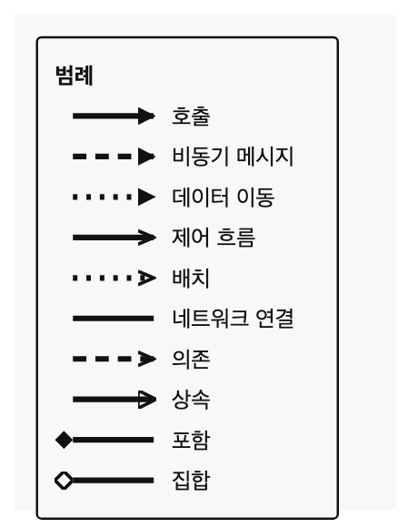
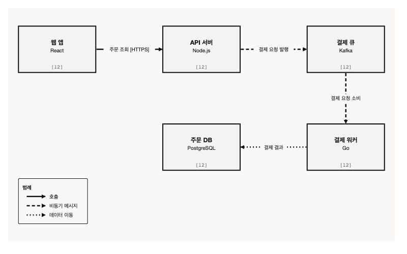
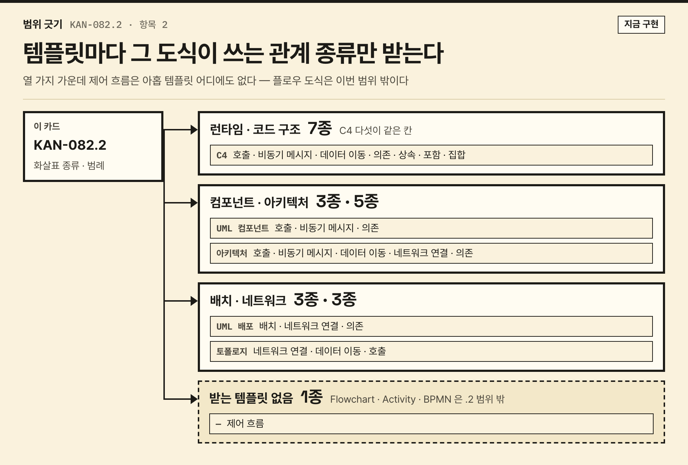

# KAN-082.2-P4970X 검토 요청 — viz 화살표 종류 구분과 범례 — 관계선 종류 데이터 + 도식 범례 부품

카드: [KAN-082.2-P4970X.md](../cards/KAN-082.2-P4970X.md)

> 이 문서는 **검토를 위해 만든 문서**다. 수행 내역은 카드 실행 문서에 있고, 시작 전
> 계획은 배치 문서에 있다. 여기 있는 것은 "지금 이 브랜치를 무엇으로 판정하는가" 뿐이다.

## 1. 검토 대상

| 항목 | 값 |
|---|---|
| 브랜치 | `KAN-082-MD50S0` |
| 워크트리 | `/Users/centurio/orca/workspaces/bbangto-ui/KAN-082-MD50S0` |
| 베이스 | `362f047` |
| 변경 훑기 | `git diff 362f047...HEAD` |

**커밋 4건**

```text
0cab764 feat(visualization): 템플릿 아홉이 관계 종류를 받고 종류가 둘 이상이면 범례를 붙인다 (KAN-082 S8)
b95be06 feat(visualization): 관계 종류 열 가지 · 선 모양 매핑 · LegendBlock 범례 + Class · ER 매핑 export (KAN-082 S7)
e882f87 test(visualization): 관계 종류 목록 · 선 모양 매핑 · 범례 견본 시험 — 구현 전 실패 (KAN-082 S6)
f4f81cf kanban: KAN-082 묶음 2 끝(태그 batch2) + 묶음 3 착수 시점 판단 + KAN-082.2 진행 중으로
```

**변경 파일 32개 (+829 −101)**

| 파일 | 상태 | 추가 | 삭제 |
|---|:--:|---:|---:|
| `.changeset/kan-082-relation-kinds.md` | M | 15 | 0 |
| `.kanban/archive.jsonl` | M | 1 | 0 |
| `.kanban/log.md` | M | 1 | 1 |
| `.kanban/state.json` | M | 15 | 15 |
| `KANBAN.board.html` | M | 2 | 2 |
| `KANBAN.md` | M | 8 | 8 |
| `KANBAN/batches/KAN-082-MD50S0.batch3.md` | M | 8 | 0 |
| `KANBAN/cards/KAN-082-MD50S0.md` | M | 8 | 3 |
| `apps/storybook/src/stories/visualization/DiagramExamples.stories.tsx` | M | 63 | 0 |
| `apps/storybook/src/stories/visualization/Molecules.stories.tsx` | M | 38 | 0 |
| `packages/visualization/README.md` | M | 10 | 0 |
| `packages/visualization/src/atoms/EdgeLabel.tsx` | M | 12 | 2 |
| `packages/visualization/src/atoms/index.ts` | M | 11 | 0 |
| `packages/visualization/src/atoms/relationKind.test.tsx` | M | 190 | 0 |
| `packages/visualization/src/atoms/relationKind.ts` | M | 152 | 0 |
| `packages/visualization/src/molecules/LegendBlock.tsx` | M | 139 | 0 |
| `packages/visualization/src/molecules/index.ts` | M | 2 | 0 |
| `packages/visualization/src/templates/ArchitectureDiagram.tsx` | M | 15 | 3 |
| `packages/visualization/src/templates/C4CodeDiagram.tsx` | M | 10 | 2 |
| `packages/visualization/src/templates/C4ComponentDiagram.tsx` | M | 10 | 3 |
| `packages/visualization/src/templates/C4ContainerDiagram.tsx` | M | 10 | 3 |
| `packages/visualization/src/templates/C4ContextDiagram.tsx` | M | 10 | 3 |
| `packages/visualization/src/templates/C4SystemLandscapeDiagram.tsx` | M | 9 | 1 |
| `packages/visualization/src/templates/ClassDiagram.tsx` | M | 4 | 29 |
| `packages/visualization/src/templates/ERDiagram.tsx` | M | 5 | 14 |
| `packages/visualization/src/templates/NetworkTopology.tsx` | M | 19 | 2 |
| `packages/visualization/src/templates/UMLComponentDiagram.tsx` | M | 15 | 3 |
| `packages/visualization/src/templates/UMLDeploymentDiagram.tsx` | M | 15 | 3 |
| `packages/visualization/src/templates/c4Types.ts` | M | 9 | 0 |
| `packages/visualization/src/templates/edgeLabels.test.tsx` | M | 17 | 0 |
| `packages/visualization/src/templates/index.ts` | M | 5 | 4 |
| `packages/visualization/visualization-type-inventory.md` | M | 1 | 0 |

**롤백 태그 9개**

```text
kan/KAN-082-MD50S0/S1
kan/KAN-082-MD50S0/S2
kan/KAN-082-MD50S0/S3
kan/KAN-082-MD50S0/S4
kan/KAN-082-MD50S0/S5
kan/KAN-082-MD50S0/S6
kan/KAN-082-MD50S0/S7
kan/KAN-082-MD50S0/batch1
kan/KAN-082-MD50S0/batch2
```

## 2. 검증 — 기준과 실행 결과

<!-- 기준은 카드 실행 문서 「검증」 절의 사본이다. 원본은 KANBAN/cards/KAN-082.2-P4970X.md 이므로
     기준이 바뀌면 그쪽을 고치고 review-init --refresh 로 이 항만 다시 만든다.
     결과는 작업한 쪽이 이미 돌린 것이다 — 검토자에게 다시 돌리라고 시키지 않는다.
     **다시 돌려 아래와 다르게 나오면 그 자체가 반려할 이유다.** -->

**기준**

- 관계 종류 시험(vitest): `packages/visualization/src/atoms/relationKind.test.tsx` — 목록 열 가지 · 선 모양이 서로 다름 · 실선은 대시 none · 범례 이름 · Class/ER 매핑 export, 템플릿 아홉에서 범례 견본 선 = 템플릿 선 · 종류를 안 적으면 범례 없음 · 범례 상자 안에 시작 마커.
- 라벨 폭 시험: `packages/visualization/src/templates/edgeLabels.test.tsx` 의 edgeLabelBox(한글 1em).
- Storybook play: `VISUALIZATION/Molecules` LegendBlockAllKinds(견본 열 · 이름 · 대시 · 화살촉) · `Templates/Diagram Examples` RuntimeMixedArrowsWithLegend(범례 항목 수 = 쓰인 종류 수, 견본 선 = 관계선).
- 품질 게이트 다섯이 초록이다: `pnpm typecheck` · `pnpm build` · `pnpm test` · `pnpm --filter storybook build` · `pnpm test:unit`.

**실행 결과**

```text
게이트 다섯 (2026-11-25, 워크트리 KAN-082-MD50S0, S8 커밋 0cab764 시점)
pnpm typecheck            → rc=0
pnpm build                → rc=0 · 번들 크기 게이트 Tests 23 passed (23)
                            (그 앞 두 번은 부하 평균 20 안팎에서 측정기 자체 시험이 5초 제한에 걸려 1 failed — 단독 실행 두 번 23/23, 세 번째 pnpm build 통과)
pnpm test                 → rc=0 · Test Files 199 passed (199) · Tests 1320 passed (1320)
pnpm --filter storybook build → rc=0
pnpm test:unit            → rc=0 · hooks 115 · foundations 143 · visualization 403 · style-guide-catalog 116 · visualization-style-guide-catalog 85

관계 종류 시험(packages/visualization/src/atoms/relationKind.test.tsx) 24건 통과
  목록 · 선 모양 열 가지가 서로 다름 · 실선 none · 범례 이름 · Class/ER 매핑 export
  템플릿 아홉: 종류 둘 → 범례 항목 둘, 견본 선 = 그 종류의 관계선 / 종류 없음 → 범례 없음
Storybook: Molecules LegendBlockAllKinds · Diagram Examples RuntimeMixedArrowsWithLegend 통과
a11y: 바꾼 스토리 파일 둘을 a11y test:'error' 로 임시 강제 → 위반 0
```

## 3. 판단 항목 — 스크립트가 판정할 수 없는 것

<!-- 스크립트가 판정할 수 없는 것만 적는다 — 값의 진위, 선택지 중 하나를 고른 근거,
     범위를 정한 기준. 2항에서 이미 돌아간 검증을 여기 옮겨 적지 않는다.
     한 줄 형식: 체크박스 하나에 의견 하나 — "<주제> — <지금 고른 값과 그 근거>".
     **의견마다 상세가 따라붙고, 상세는 조각 둘이다** — `**배경**` 과 `**정할 것**` 이
     각각 단독 줄이다(없거나 하나뿐이면 종료코드 12). 검토자는 이 카드를 수행하지
     않았으므로 내부 기호(`L10`·`P5`·`S8`)만 던지면 판정할 재료가 없고, 재료가 있어도
     줄글 한 덩이면 필요한 부분만 골라 읽지 못한다.
       **보기** — 그림이 설명보다 먼저다. `- 종류: 동작|설계|결과물` 과 `- `, 그릴 것이
         없으면 `- 종류: 없음 — <이유>`. 그림은 `review-attach` 로 붙인다(SKILL.md 5.6).
       **배경** — 무엇이 문제인가. `- ` 목록으로, 항목 하나에 사실 하나. 기호를 풀어 쓰고
         항목 끝에 `원문: 파일:줄` 이나 링크를 건다. ①②… 로 늘어놓을 것은 항목으로 가른다.
         목록이 없으면 종료코드 12 — 줄글은 화면에서 한 문단으로 붙는다.
       **정할 것** — 정할 것 한 줄. 그 아래 갈래마다 대가와 결과를 표로 단다:
         | 선택지 | 대가 | 그러면 어떻게 되는가 |
       추천은 선택지 셀 맨 앞의 `**추천** ` 접두다. 「~가 맞는가」로만 묻더라도 아니라고 답할 때
         갈 길(고친다 · 뺀다 · 미룬다)이 있으면 그 길을 갈래로 적는다 — 화면에서 표 없는 항목은
         「승인」 · 「직접 적기」 둘뿐이다. 정말 동의만 구하는 항목이면 표를 비운다.
     **말투와 낱말(SKILL.md 5.10).** 주제 · 배경 · 정할 것은 존댓말(합쇼체 — 「~합니다」 ·
     「~할까요?」)로 쓰고, 이 스킬 안에서만 통하는 낱말과 잘 쓰이지 않는 한자어를 쓰지 않는다 — 목록은 manage-kanban 의
     assets/writing/words.md 이고, 쓰면 경고가 뜬다. 여러 낱말로 된 약속된 용어(「기획 결정」 등)는
     「」로 감싸 앞뒤 글과 구분한다.
     **올리기 전에 둘을 본다.** ① 이 의견이 카드 의도(원문·목적·이유·목표)와 이어지는가
     — 이어지지 않으면 올리지 않는다. 문제를 위한 문제는 판단 항목이 아니라 별도 카드다.
     ② 지시 원본보다 낮은 레이어로 내려가지 않았는가 — 유저가 제품 관점으로 지시했는데
     플래그 이름·함수 이름을 묻고 있으면 서술을 고칠 것이 아니라 올릴 것이 아니다.
     (SKILL.md 5.6 「판단 항목에 무엇을 올리는가」)
     비어 있으면 "기계가 다 판정했고 사람이 정할 것이 없다"는 뜻이다. 그 판단도
     작업한 쪽이 하는 것이지 검토자가 빈칸을 보고 추측할 일이 아니다.
     **넘겨받은 절(3-0, `--inherit`)이 있으면 그것이 먼저 온다** — 다른 검토서에서 넘어온 의견이고,
     판정은 그것을 넘겨받은 이 문서 하나에서만 내려진다. -->

**의견마다 선택지를 고르거나 추가 의견을 답니다.** 「정할 것」 표가 있으면 선택지 하나를 고르고, 표가 없으면
그 의견을 승인합니다. 고른 순간 그 항목은 승인이고, 마음에 드는 선택지가 없으면 추가 의견을 적습니다 —
그 항목은 열린 채 남습니다. 의견 하나만 먼저 고를 수도 있습니다. 검토 화면에서는 「제출」 한 번으로 보냅니다.
`<번호>`는 의견 순서이고, 주제의 문구 일부로도 찾습니다.

```
# 고르기 — 갈래 번호(1부터)나 이름. 표가 없는 항목은 --choice 없이(그 의견의 승인)
python3 scripts/kanban.py review-choose <project-root> --card KAN-082.2-P4970X --item <번호> --choice <번호|이름>
# 추가 의견
python3 scripts/kanban.py review-note <project-root> --card KAN-082.2-P4970X --item <번호> --text "<추가 의견>"
# 반려 · 철회 — 화면에는 없고 명령에만 있습니다
python3 scripts/kanban.py review-judge <project-root> --card KAN-082.2-P4970X --item <번호> --verdict 반려|철회
# 추가 의견을 반영하다 새 의견이 생겼으면 (맨 뒤에 붙어 앞 번호가 안 밀립니다)
python3 scripts/kanban.py review-item <project-root> --card KAN-082.2-P4970X --add "<주제>
  <상세>"
```

**전체 승인은 살아있는 항목이 전부 승인일 때만 섭니다**(철회는 분모에서 빠집니다). 하나라도
반려·추가 의견·미정이면 4항의 전체 승인도 `→ 완료` 이동도 종료코드 14로 거부됩니다.

- [ ] 관계 종류 열 가지의 선 모양을 이대로 둘까요 — 호출 · 제어 흐름 · 상속은 화살촉 모양으로만 갈립니다
    - **보기**
      - 종류: 동작
      - 
      - 
    - **배경**
      - 원문 규칙은 「화살표 의미를 섞어야 한다면 범례로 화살표 종류를 구분해 표시하는 게 좋습니다」입니다. 원문: KANBAN.md 의 KAN-082-MD50S0 카드 원문 블록
      - 열 가지는 대시(실선 · 긴 점선 · 짧은 점선)와 양 끝 화살촉의 짝으로 모두 다르게 했습니다. 원문: packages/visualization/src/atoms/relationKind.ts:58
      - 색으로는 가르지 않았습니다. 선 색은 스타일 가이드가 정하는 값이라, 종류마다 색을 고정하면 가이드마다 다른 색 체계와 부딪힙니다.
      - 호출(채운 화살촉) · 제어 흐름(열린 화살촉) · 상속(빈 삼각형)은 셋 다 실선이라 화살촉으로만 갈립니다. 작은 그림에서는 가까이 봐야 갈립니다. 다만 셋은 각각 런타임 · 플로우 · 클래스 도식에 쓰여 한 그림에 함께 나올 일이 드뭅니다.
      - 실선 종류는 대시를 none 으로 고정해, 점선을 쓰는 스타일 가이드에서도 실선으로 남습니다. 원문: packages/visualization/README.md:339
    - **정할 것**
      선 모양을 이대로 둘까요?

    | 선택지 | 대가 | 그러면 어떻게 되는가 |
    | --- | --- | --- |
    | **추천** 이대로 둔다 | 호출 · 제어 흐름 · 상속은 작은 그림에서 가까이 봐야 갈립니다 | 지금 그림 그대로입니다 |
    | 제어 흐름을 굵은 실선으로 바꿔 더 크게 가른다 | 선 굵기가 뜻을 갖게 되어 스타일 가이드의 선 굵기 설정과 섞입니다 | 셋이 한눈에 갈립니다 |

    > **판정** — _아직 없습니다._

    > **추가 의견** — _아직 없습니다._

- [ ] 템플릿마다 그 도식이 쓰는 관계 종류만 받게 했는데 이 범위로 둘까요 — 제어 흐름은 아홉 템플릿 어디에도 없습니다
    - **보기**
      - 종류: 설계
      - 
    - **배경**
      - 계획의 「정할 것」 2 추천(고정 목록을 내고 템플릿은 그중 쓰는 것만 받는다)대로 했습니다. 원문: KANBAN/cards/KAN-082-MD50S0.md:92
      - 템플릿마다 받는 종류는 원문 표의 「화살표의 의미」 칸에서 골랐습니다 — 배포 도식은 네트워크 연결 · 배치, 런타임 도식은 호출 · 통신입니다. 원문: KANBAN.md 의 KAN-082-MD50S0 카드 원문 블록
      - 계획에서 종류를 붙이기로 한 템플릿은 C4 · UML 배포 · 컴포넌트 · 아키텍처 · 네트워크 토폴로지입니다. 플로우 도식(Flowchart · Activity · BPMN)은 화살표가 모두 제어 흐름이라 섞일 일이 없어 넣지 않았습니다. 원문: KANBAN/cards/KAN-082-MD50S0.md:114
      - 받는 종류는 타입에서만 막습니다. 실행 중에는 어떤 종류를 넣어도 그 종류의 모양으로 그립니다.
    - **정할 것**
      템플릿마다 받는 종류를 이 범위로 둘까요?

    | 선택지 | 대가 | 그러면 어떻게 되는가 |
    | --- | --- | --- |
    | **추천** 이대로 둔다 | 범위 밖 종류를 쓰려면 타입을 넓히는 변경이 필요합니다 | 도식에 맞지 않는 화살표를 타입이 막아 줍니다 |
    | 모든 템플릿이 열 가지를 다 받는다 | 배포 도식에 상속처럼 어울리지 않는 종류도 들어갑니다 | 쓰는 쪽이 종류를 고를 때 막힘이 없습니다 |
    | 플로우 도식(Flowchart · Activity)에도 제어 흐름 · 데이터 이동을 붙인다 | .2 범위가 계획보다 커집니다 | 플로우차트에 데이터 흐름을 섞어 그릴 수 있습니다 |

    > **판정** — _아직 없습니다._

    > **추가 의견** — _아직 없습니다._


## 4. 판정

<!-- 문서 하나에 대한 판정이다. **항목별로 갈리는 말은 여기 적지 않는다** — 3항 각 의견의
     「판정」과 「추가 의견」에 적는다. 여기 남는 것은 그 항목들이 전부 승인으로 닫혔다는
     사실 하나뿐이다.
     아래 「판정 이력」은 **덧붙기만 하는 이력**이다. 왕복이 돌면 줄이 쌓이고, 그것이 이 문서가
     무엇을 거쳐 승인에 닿았는지의 전부다 — 지우지 않는다. **판정에는 이유를 적는 칸이 없다** —
     승인은 대체로 덧붙일 말이 없고, 있다면 그것은 문서 전체가 아니라 그 항목에 대한
     말이라 3항의 「추가 의견」이 받는다.
     `review-judge --card KAN-082.2-P4970X --verdict 승인` 이 이 판정을 적고
     frontmatter 의 status 도 함께 고친다. 손으로 적어도 되지만, 그때는 수렴 검사를
     안 거치므로 `validate` 가 항목 판정과 어긋난 승인을 error 로 잡는다. -->

**판정**: (아직 없습니다)

**판정 이력**:

- 승인이면 → `apply --op move --id KAN-082.2-P4970X --to done` 뒤에 `main` 병합과 워크트리 정리(출력의 `cleanup`)
- 반려면 → `apply --op move --id KAN-082.2-P4970X --to doing` 뒤에 `doc-log --entry "<반려 이유>"`.
  검토서는 **지우지도 새로 만들지도 않습니다** — 고친 뒤 그 항목을 `review-judge --verdict 승인` 으로
  바꾸면 같은 문서에서 모든 항목이 승인될 때까지 이어 갑니다. 1·2항이 최신이 아니면 `review-init --refresh` 로 그 두 항만 새로 씁니다.
