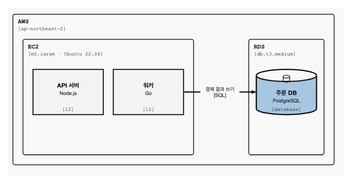
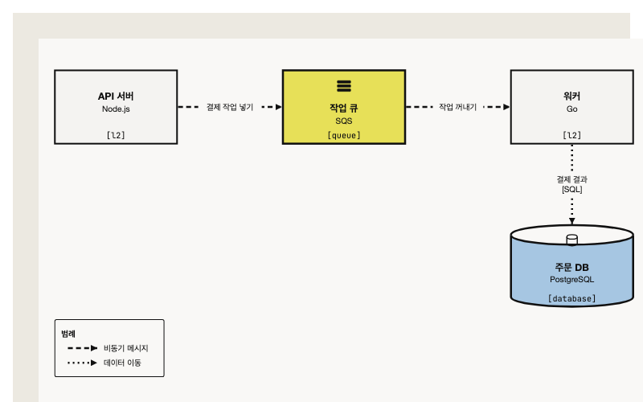
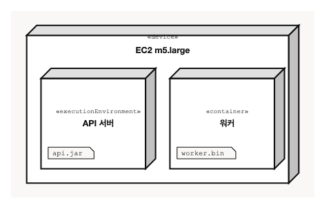

# KAN-082.3-TJ665Y 검토 요청 — viz 배치 도식 보강 — 노드 중첩·스테레오타입·artifact, C4 Deployment 템플릿, C4 컨테이너 모양, 토폴로지 링크 라벨

카드: [KAN-082.3-TJ665Y.md](../cards/KAN-082.3-TJ665Y.md)

> 이 문서는 **검토를 위해 만든 문서**다. 수행 내역은 카드 실행 문서에 있고, 시작 전
> 계획은 배치 문서에 있다. 여기 있는 것은 "지금 이 브랜치를 무엇으로 판정하는가" 뿐이다.

## 1. 검토 대상

| 항목 | 값 |
|---|---|
| 브랜치 | `KAN-082-MD50S0` |
| 워크트리 | `/Users/centurio/orca/workspaces/bbangto-ui/KAN-082-MD50S0` |
| 베이스 | `7d80338` |
| 변경 훑기 | `git diff 7d80338...HEAD` |

**커밋 10건**

```text
7b214c2 kanban: KAN-082 S19 완료 + KAN-082.1 검토서 — 세 항목에 고친 그림 · 결과 의견, 1 · 2항 새로 고침(다시 판정 요청)
a1e7c80 feat(visualization): C4DeploymentDiagram — 배포 노드 중첩 위 컨테이너 인스턴스, VT-104 별칭으로 등록 (KAN-082 S11)
7703008 feat(visualization): 배포 노드 중첩 · 종류 · stereotype · artifact, 토폴로지 링크 라벨, C4 컨테이너 모양 (KAN-082 S10)
575b8ca feat(visualization): Flowchart 선이 fromSide · toSide · waypoints 를 받고 원문 예시에 돌아가는 선 (KAN-082 S19 진행 · .1 검토 3번)
7cbc764 fix(visualization): 마커가 노드 테두리를 넘지 않게 — 시작 마커 방향 · 화살촉 기준점 · 선 끝 간격 · ER 까마귀발 (KAN-082 S18 · .1 검토 2번)
69fdaf2 feat(visualization): 선 라벨이 줄바꿈을 받고 C4 관계선 글을 「설명」 아래 「[기술]」 두 줄로 (KAN-082 S17 · .1 검토 1번)
a6e8328 kanban: KAN-082 실행 계획에 S17~S19(묶음 7) — KAN-082.1 검토 결과 반영(두 줄 라벨 · 화살촉 겹침 QA · 돌아가는 선) + 세 항목에 할 일 의견
eb0b1f6 kanban: KAN-082.1 · .2 검토 제출 반영 — .1 승인 2/3(1번 두 줄 · 3번 fromSide/toSide 고름) · 추가 의견 1(화살촉 겹침 QA), .2 승인 2/2
fa02c65 test(visualization): 배포 노드 중첩 · 종류 · artifact, 토폴로지 링크 라벨, C4 컨테이너 모양, C4DeploymentDiagram 시험 — 구현 전 실패 (KAN-082 S9)
9643f92 kanban: KAN-082 묶음 3 끝(태그 batch3) + 묶음 4 착수 시점 판단 + KAN-082.3 진행 중으로
```

**변경 파일 44개 (+1235 −197)**

| 파일 | 상태 | 추가 | 삭제 |
|---|:--:|---:|---:|
| `.changeset/kan-082-deployment.md` | M | 14 | 0 |
| `.changeset/kan-082-edge-labels.md` | M | 4 | 2 |
| `.kanban/archive.jsonl` | M | 1 | 0 |
| `.kanban/log.md` | M | 1 | 1 |
| `.kanban/reviews/KAN-082.1-ZFJJM6.events.jsonl` | M | 13 | 0 |
| `.kanban/reviews/KAN-082.1-ZFJJM6.review.json` | M | 4 | 4 |
| `.kanban/reviews/KAN-082.2-P4970X.events.jsonl` | M | 2 | 0 |
| `.kanban/state.json` | M | 15 | 15 |
| `KANBAN.board.html` | M | 2 | 2 |
| `KANBAN.md` | M | 10 | 10 |
| `KANBAN/batches/KAN-082-MD50S0.batch4.md` | M | 8 | 0 |
| `KANBAN/batches/KAN-082-MD50S0.batch7.md` | M | 46 | 0 |
| `KANBAN/cards/KAN-082-MD50S0.md` | M | 15 | 2 |
| `KANBAN/reviews/KAN-082.1-ZFJJM6.assets/1de6fabeaf8c.png` | B | 0 | 0 |
| `KANBAN/reviews/KAN-082.1-ZFJJM6.assets/48d6481c031a.png` | B | 0 | 0 |
| `KANBAN/reviews/KAN-082.1-ZFJJM6.assets/4c04cd899253.png` | B | 0 | 0 |
| `KANBAN/reviews/KAN-082.1-ZFJJM6.assets/86e0fdaf0bd7.png` | B | 0 | 0 |
| `KANBAN/reviews/KAN-082.1-ZFJJM6.review.html` | M | 47 | 23 |
| `KANBAN/reviews/KAN-082.1-ZFJJM6.review.md` | M | 128 | 43 |
| `KANBAN/reviews/KAN-082.2-P4970X.review.html` | M | 7 | 7 |
| `apps/storybook/src/stories/visualization/DiagramExamples.stories.tsx` | M | 96 | 3 |
| `apps/storybook/src/stories/visualization/TemplateDashGate.stories.tsx` | M | 2 | 0 |
| `apps/storybook/src/stories/visualization/_paintGateFixtures.tsx` | M | 22 | 0 |
| `packages/foundations/src/vizPaintGateCoverage.test.ts` | M | 2 | 2 |
| `packages/visualization/README.md` | M | 6 | 0 |
| `packages/visualization/src/atoms/Edge.tsx` | M | 10 | 3 |
| `packages/visualization/src/atoms/EdgeLabel.tsx` | M | 23 | 7 |
| `packages/visualization/src/atoms/Marker.test.tsx` | M | 127 | 0 |
| `packages/visualization/src/atoms/Marker.tsx` | M | 23 | 23 |
| `packages/visualization/src/templates/C4ContainerDiagram.tsx` | M | 14 | 12 |
| `packages/visualization/src/templates/C4DeploymentDiagram.tsx` | M | 171 | 0 |
| `packages/visualization/src/templates/Flowchart.tsx` | M | 13 | 1 |
| `packages/visualization/src/templates/NetworkTopology.tsx` | M | 6 | 2 |
| `packages/visualization/src/templates/UMLDeploymentDiagram.tsx` | M | 94 | 17 |
| `packages/visualization/src/templates/c4Types.ts` | M | 8 | 3 |
| `packages/visualization/src/templates/deployment.test.tsx` | M | 147 | 0 |
| `packages/visualization/src/templates/edgeLabels.test.tsx` | M | 81 | 3 |
| `packages/visualization/src/templates/flowchart.test.tsx` | M | 56 | 0 |
| `packages/visualization/src/templates/index.ts` | M | 4 | 2 |
| `packages/visualization/src/typeMeta/jsdoc.test.ts` | M | 2 | 1 |
| `packages/visualization/src/typeMeta/registry.test.ts` | M | 6 | 6 |
| `packages/visualization/src/typeMeta/registry.ts` | M | 2 | 1 |
| `packages/visualization/type.manifest.json` | M | 1 | 1 |
| `packages/visualization/visualization-type-inventory.md` | M | 2 | 1 |

**롤백 태그 17개**

```text
kan/KAN-082-MD50S0/S1
kan/KAN-082-MD50S0/S10
kan/KAN-082-MD50S0/S17
kan/KAN-082-MD50S0/S18
kan/KAN-082-MD50S0/S19
kan/KAN-082-MD50S0/S2
kan/KAN-082-MD50S0/S3
kan/KAN-082-MD50S0/S4
kan/KAN-082-MD50S0/S5
kan/KAN-082-MD50S0/S6
kan/KAN-082-MD50S0/S7
kan/KAN-082-MD50S0/S8
kan/KAN-082-MD50S0/S9
kan/KAN-082-MD50S0/batch1
kan/KAN-082-MD50S0/batch2
kan/KAN-082-MD50S0/batch3
kan/KAN-082-MD50S0/batch7
```

## 2. 검증 — 기준과 실행 결과

<!-- 기준은 카드 실행 문서 「검증」 절의 사본이다. 원본은 KANBAN/cards/KAN-082.3-TJ665Y.md 이므로
     기준이 바뀌면 그쪽을 고치고 review-init --refresh 로 이 항만 다시 만든다.
     결과는 작업한 쪽이 이미 돌린 것이다 — 검토자에게 다시 돌리라고 시키지 않는다.
     **다시 돌려 아래와 다르게 나오면 그 자체가 반려할 이유다.** -->

**기준**

- 배치 도식 시험(vitest): `packages/visualization/src/templates/deployment.test.tsx` — 노드 중첩(부모 표시 · 그리는 순서 · 이름 위치) · 종류 · stereotype · artifact, 토폴로지 링크 라벨, C4 컨테이너 모양, C4DeploymentDiagram(중첩 노드 · 컨테이너 인스턴스 · VT-104).
- 유형 축 시험: `registry.test.ts`(템플릿 69 · 스캔 91 · 덮인 export 88) · `jsdoc.test.ts`(export 88) · `manifest.test.ts`(유형 87 그대로).
- 게이트 표본: foundations `vizPaintGateCoverage.test.ts`(69) · Storybook Paint Gate · Dash Gate.
- Storybook play: `Templates/Diagram Examples` DeploymentOneEc2 · RuntimeTwoContainers(원문 「EC2 하나에 API 서버와 워커」).
- 품질 게이트 다섯이 초록이다: `pnpm typecheck` · `pnpm build` · `pnpm test` · `pnpm --filter storybook build` · `pnpm test:unit`.

**실행 결과**

```text
게이트 다섯 (2026-11-25, 워크트리 KAN-082-MD50S0, S11 커밋 a1e7c80 시점)
pnpm typecheck            → rc=0
pnpm build                → rc=0 · 번들 크기 게이트 Tests 23 passed (23)
pnpm test                 → rc=0 · Test Files 199 passed (199) · Tests 1322 passed (1322)
pnpm --filter storybook build → rc=0
pnpm test:unit            → rc=0 · hooks 115 · foundations 143 · visualization 448 · style-guide-catalog 116 · visualization-style-guide-catalog 85

배치 도식 시험(deployment.test.tsx) 13 건 통과 — S9 에서 구현 전 빨강을 확인
유형 축: registry 69/91/88 · jsdoc export 88 · manifest 유형 87(그대로) 통과
첫 게이트 실행에서 둘이 빨갛게 나와 고쳤다 — Dash Gate(C4DeploymentDiagram 을 C4 목록에), Paint Gate 커버리지(표본 하나 · 수 69)
a11y: DiagramExamples 를 a11y test:'error' 로 임시 강제 → 5 건 위반 0
```

## 3. 판단 항목 — 스크립트가 판정할 수 없는 것

<!-- 스크립트가 판정할 수 없는 것만 적는다 — 값의 진위, 선택지 중 하나를 고른 근거,
     범위를 정한 기준. 2항에서 이미 돌아간 검증을 여기 옮겨 적지 않는다.
     한 줄 형식: 체크박스 하나에 의견 하나 — "<주제> — <지금 고른 값과 그 근거>".
     **의견마다 상세가 따라붙고, 상세는 조각 둘이다** — `**배경**` 과 `**정할 것**` 이
     각각 단독 줄이다(없거나 하나뿐이면 종료코드 12). 검토자는 이 카드를 수행하지
     않았으므로 내부 기호(`L10`·`P5`·`S8`)만 던지면 판정할 재료가 없고, 재료가 있어도
     줄글 한 덩이면 필요한 부분만 골라 읽지 못한다.
       **보기** — 그림이 설명보다 먼저다. `- 종류: 동작|설계|결과물` 과 `- `, 그릴 것이
         없으면 `- 종류: 없음 — <이유>`. 그림은 `review-attach` 로 붙인다(SKILL.md 5.6).
       **배경** — 무엇이 문제인가. `- ` 목록으로, 항목 하나에 사실 하나. 기호를 풀어 쓰고
         항목 끝에 `원문: 파일:줄` 이나 링크를 건다. ①②… 로 늘어놓을 것은 항목으로 가른다.
         목록이 없으면 종료코드 12 — 줄글은 화면에서 한 문단으로 붙는다.
       **정할 것** — 정할 것 한 줄. 그 아래 갈래마다 대가와 결과를 표로 단다:
         | 선택지 | 대가 | 그러면 어떻게 되는가 |
       추천은 선택지 셀 맨 앞의 `**추천** ` 접두다. 「~가 맞는가」로만 묻더라도 아니라고 답할 때
         갈 길(고친다 · 뺀다 · 미룬다)이 있으면 그 길을 갈래로 적는다 — 화면에서 표 없는 항목은
         「승인」 · 「직접 적기」 둘뿐이다. 정말 동의만 구하는 항목이면 표를 비운다.
     **말투와 낱말(SKILL.md 5.10).** 주제 · 배경 · 정할 것은 존댓말(합쇼체 — 「~합니다」 ·
     「~할까요?」)로 쓰고, 이 스킬 안에서만 통하는 낱말과 잘 쓰이지 않는 한자어를 쓰지 않는다 — 목록은 manage-kanban 의
     assets/writing/words.md 이고, 쓰면 경고가 뜬다. 여러 낱말로 된 약속된 용어(「기획 결정」 등)는
     「」로 감싸 앞뒤 글과 구분한다.
     **올리기 전에 둘을 본다.** ① 이 의견이 카드 의도(원문·목적·이유·목표)와 이어지는가
     — 이어지지 않으면 올리지 않는다. 문제를 위한 문제는 판단 항목이 아니라 별도 카드다.
     ② 지시 원본보다 낮은 레이어로 내려가지 않았는가 — 유저가 제품 관점으로 지시했는데
     플래그 이름·함수 이름을 묻고 있으면 서술을 고칠 것이 아니라 올릴 것이 아니다.
     (SKILL.md 5.6 「판단 항목에 무엇을 올리는가」)
     비어 있으면 "기계가 다 판정했고 사람이 정할 것이 없다"는 뜻이다. 그 판단도
     작업한 쪽이 하는 것이지 검토자가 빈칸을 보고 추측할 일이 아니다.
     **넘겨받은 절(3-0, `--inherit`)이 있으면 그것이 먼저 온다** — 다른 검토서에서 넘어온 의견이고,
     판정은 그것을 넘겨받은 이 문서 하나에서만 내려진다. -->

**의견마다 선택지를 고르거나 추가 의견을 답니다.** 「정할 것」 표가 있으면 선택지 하나를 고르고, 표가 없으면
그 의견을 승인합니다. 고른 순간 그 항목은 승인이고, 마음에 드는 선택지가 없으면 추가 의견을 적습니다 —
그 항목은 열린 채 남습니다. 의견 하나만 먼저 고를 수도 있습니다. 검토 화면에서는 「제출」 한 번으로 보냅니다.
`<번호>`는 의견 순서이고, 주제의 문구 일부로도 찾습니다.

```
# 고르기 — 갈래 번호(1부터)나 이름. 표가 없는 항목은 --choice 없이(그 의견의 승인)
python3 scripts/kanban.py review-choose <project-root> --card KAN-082.3-TJ665Y --item <번호> --choice <번호|이름>
# 추가 의견
python3 scripts/kanban.py review-note <project-root> --card KAN-082.3-TJ665Y --item <번호> --text "<추가 의견>"
# 반려 · 철회 — 화면에는 없고 명령에만 있습니다
python3 scripts/kanban.py review-judge <project-root> --card KAN-082.3-TJ665Y --item <번호> --verdict 반려|철회
# 추가 의견을 반영하다 새 의견이 생겼으면 (맨 뒤에 붙어 앞 번호가 안 밀립니다)
python3 scripts/kanban.py review-item <project-root> --card KAN-082.3-TJ665Y --add "<주제>
  <상세>"
```

**전체 승인은 살아있는 항목이 전부 승인일 때만 섭니다**(철회는 분모에서 빠집니다). 하나라도
반려·추가 의견·미정이면 4항의 전체 승인도 `→ 완료` 이동도 종료코드 14로 거부됩니다.

- [ ] 원문의 「EC2 하나에 API 서버와 워커」를 배포 도식(상자 하나 안의 둘)과 런타임 도식(상자 둘)으로 옮겼는데 원문 뜻과 맞을까요
    - **보기**
      - 종류: 동작
      - 
      - 
    - **배경**
      - 원문은 「하나의 EC2 위에 API 서버와 워커가 같이 떠 있다면, 배포 도식에서는 박스 하나고 런타임 도식에서는 박스 두 개입니다」입니다. 원문: KANBAN.md 의 KAN-082-MD50S0 카드 원문 블록
      - 배포 도식은 새 템플릿 C4DeploymentDiagram 으로 그렸습니다. 배포 노드(AWS › EC2)가 겹쳐 들어가고, 컨테이너가 자기 노드 안에 놓입니다. 원문: packages/visualization/src/templates/C4DeploymentDiagram.tsx:62
      - 런타임 도식은 C4ContainerDiagram 이고, 이번에 연 컨테이너 모양 칸(DB · 큐)과 관계 종류(비동기 메시지 · 데이터 이동)를 썼습니다. 원문: packages/visualization/src/templates/c4Types.ts:36
      - 두 그림이 「몇 대에 어떻게 나뉘어 있나」와 「무엇이 서로 통신하나」에 답하는지는 스토리 play 가 잽니다 — 배포 도식은 두 컨테이너가 EC2 상자 안에 있는지, 런타임 도식은 API 서버와 워커가 따로 있는지를 봅니다.
    - **정할 것**
      두 그림이 원문 뜻을 맞게 옮겼을까요? 다르게 보이는 곳이 있으면 의견으로 알려 주세요.

    > **판정** — _아직 없습니다._

    > **추가 의견** — _아직 없습니다._

- [ ] UML 배포 도식의 노드 중첩은 좌표를 데이터가 주는 방식(자동 배치 없음)으로 했는데 이대로 둘까요
    - **보기**
      - 종류: 동작
      - 
    - **배경**
      - 계획 묶음 4 의 리스크는 「부모 상자 크기는 데이터가 적고 자동 배치는 하지 않는 쪽으로 좁힌다」였고 그대로 했습니다. 원문: KANBAN/batches/KAN-082-MD50S0.batch4.md:41
      - 데이터에는 자식 노드에 부모 id(parent)만 더 적습니다. 템플릿은 부모를 먼저 그리고, 자식이 있는 노드의 이름을 상자 위쪽으로 올립니다.
      - 이 저장소의 도식 템플릿은 모두 좌표를 데이터가 주는 방식이라, 배포 도식만 자동 배치를 하면 쓰는 법이 혼자 달라집니다. 원문: packages/visualization/README.md:182
      - 자식이 부모 상자 밖으로 나가도 템플릿은 막거나 고치지 않습니다.
    - **정할 것**
      노드 중첩을 이대로 좌표 방식으로 둘까요?

    | 선택지 | 대가 | 그러면 어떻게 되는가 |
    | --- | --- | --- |
    | **추천** 이대로 둔다(좌표는 데이터가 준다) | 자식 좌표를 쓰는 쪽이 계산해야 합니다 | 다른 템플릿과 쓰는 법이 같습니다 |
    | 자식을 부모 안에 자동으로 나란히 놓는 배치를 더한다 | 배포 도식만 쓰는 법이 달라지고 .3 범위가 커집니다 | 부모와 자식 목록만 적어도 그려집니다 |
    | 자식이 부모 밖으로 나가면 경고만 낸다 | 경고를 볼 곳(콘솔)이 화면 밖입니다 | 좌표 실수를 일찍 알아챕니다 |

    > **판정** — _아직 없습니다._

    > **추가 의견** — _아직 없습니다._


## 4. 판정

<!-- 문서 하나에 대한 판정이다. **항목별로 갈리는 말은 여기 적지 않는다** — 3항 각 의견의
     「판정」과 「추가 의견」에 적는다. 여기 남는 것은 그 항목들이 전부 승인으로 닫혔다는
     사실 하나뿐이다.
     아래 「판정 이력」은 **덧붙기만 하는 이력**이다. 왕복이 돌면 줄이 쌓이고, 그것이 이 문서가
     무엇을 거쳐 승인에 닿았는지의 전부다 — 지우지 않는다. **판정에는 이유를 적는 칸이 없다** —
     승인은 대체로 덧붙일 말이 없고, 있다면 그것은 문서 전체가 아니라 그 항목에 대한
     말이라 3항의 「추가 의견」이 받는다.
     `review-judge --card KAN-082.3-TJ665Y --verdict 승인` 이 이 판정을 적고
     frontmatter 의 status 도 함께 고친다. 손으로 적어도 되지만, 그때는 수렴 검사를
     안 거치므로 `validate` 가 항목 판정과 어긋난 승인을 error 로 잡는다. -->

**판정**: (아직 없습니다)

**판정 이력**:

- 승인이면 → `apply --op move --id KAN-082.3-TJ665Y --to done` 뒤에 `main` 병합과 워크트리 정리(출력의 `cleanup`)
- 반려면 → `apply --op move --id KAN-082.3-TJ665Y --to doing` 뒤에 `doc-log --entry "<반려 이유>"`.
  검토서는 **지우지도 새로 만들지도 않습니다** — 고친 뒤 그 항목을 `review-judge --verdict 승인` 으로
  바꾸면 같은 문서에서 모든 항목이 승인될 때까지 이어 갑니다. 1·2항이 최신이 아니면 `review-init --refresh` 로 그 두 항만 새로 씁니다.
