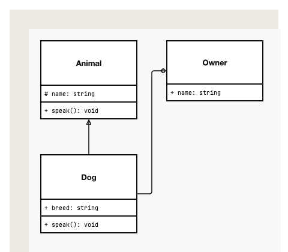
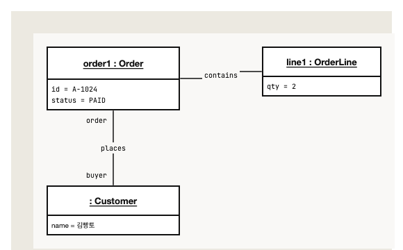
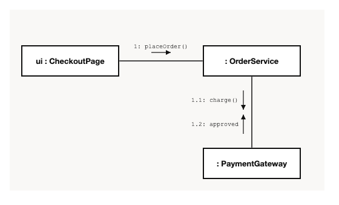
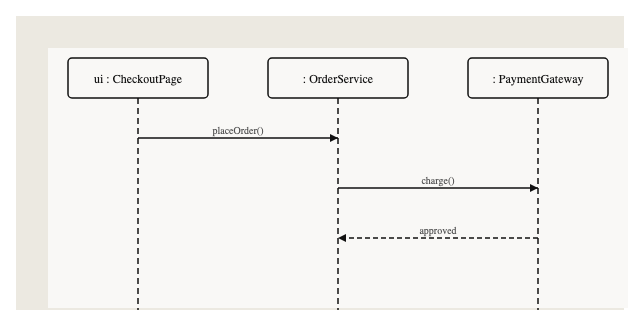

# KAN-082.4-FSH2T1 검토 요청 — viz 객체 도식·커뮤니케이션 도식 — 인스턴스 스냅샷과 링크 위 번호 메시지

카드: [KAN-082.4-FSH2T1.md](../cards/KAN-082.4-FSH2T1.md)

> 이 문서는 **검토를 위해 만든 문서**다. 수행 내역은 카드 실행 문서에 있고, 시작 전
> 계획은 배치 문서에 있다. 여기 있는 것은 "지금 이 브랜치를 무엇으로 판정하는가" 뿐이다.

## 1. 검토 대상

| 항목 | 값 |
|---|---|
| 브랜치 | `KAN-082-MD50S0` |
| 워크트리 | `/Users/centurio/orca/workspaces/bbangto-ui/KAN-082-MD50S0` |
| 베이스 | `92f7f44` |
| 변경 훑기 | `git diff 92f7f44...HEAD` |

**커밋 5건**

```text
dc9bb25 fix(visualization): CommunicationDiagram 세로 링크의 메시지를 링크를 따라 쌓아 글이 겹치지 않게 (KAN-082 S14)
69342ea feat(visualization): CommunicationDiagram — 링크 위 번호 메시지 · 방향, VT-108 별칭으로 등록 + 객체 · 커뮤니케이션 README · 변경셋 (KAN-082 S14)
d369ac0 feat(visualization): ObjectDiagram — 인스턴스 스냅샷(밑줄 이름 · 슬롯 · 링크), VT-101 별칭으로 등록 (KAN-082 S13)
5544e58 feat(visualization): ClassBox 가 빈 칸을 숨긴다 + showEmptyCompartments · nameUnderline (KAN-082 S12, 상류 이슈 P9)
9691081 kanban: KAN-082 묶음 4 끝(태그 batch4) + 묶음 5 착수 시점 판단(객체 상자는 ClassBox 재사용) + KAN-082.4 진행 중으로
```

**변경 파일 26개 (+828 −59)**

| 파일 | 상태 | 추가 | 삭제 |
|---|:--:|---:|---:|
| `.changeset/kan-082-object-communication.md` | M | 13 | 0 |
| `.kanban/archive.jsonl` | M | 1 | 0 |
| `.kanban/log.md` | M | 1 | 1 |
| `.kanban/state.json` | M | 15 | 15 |
| `KANBAN.board.html` | M | 2 | 2 |
| `KANBAN.md` | M | 8 | 8 |
| `KANBAN/batches/KAN-082-MD50S0.batch5.md` | M | 6 | 0 |
| `KANBAN/cards/KAN-082-MD50S0.md` | M | 6 | 2 |
| `apps/storybook/src/stories/visualization/DiagramExamples.stories.tsx` | M | 91 | 0 |
| `apps/storybook/src/stories/visualization/G3Templates.stories.tsx` | M | 45 | 2 |
| `apps/storybook/src/stories/visualization/_paintGateFixtures.tsx` | M | 42 | 0 |
| `packages/foundations/src/vizPaintGateCoverage.test.ts` | M | 2 | 2 |
| `packages/visualization/README.md` | M | 5 | 0 |
| `packages/visualization/src/molecules/ClassBox.test.tsx` | M | 63 | 0 |
| `packages/visualization/src/molecules/ClassBox.tsx` | M | 24 | 12 |
| `packages/visualization/src/templates/CommunicationDiagram.tsx` | M | 180 | 0 |
| `packages/visualization/src/templates/ObjectDiagram.tsx` | M | 129 | 0 |
| `packages/visualization/src/templates/communicationDiagram.test.tsx` | M | 84 | 0 |
| `packages/visualization/src/templates/edgeLabels.test.tsx` | M | 33 | 1 |
| `packages/visualization/src/templates/index.ts` | M | 4 | 0 |
| `packages/visualization/src/templates/objectDiagram.test.tsx` | M | 56 | 0 |
| `packages/visualization/src/typeMeta/jsdoc.test.ts` | M | 2 | 2 |
| `packages/visualization/src/typeMeta/registry.test.ts` | M | 6 | 6 |
| `packages/visualization/src/typeMeta/registry.ts` | M | 4 | 2 |
| `packages/visualization/type.manifest.json` | M | 2 | 2 |
| `packages/visualization/visualization-type-inventory.md` | M | 4 | 2 |

**롤백 태그 21개**

```text
kan/KAN-082-MD50S0/S1
kan/KAN-082-MD50S0/S10
kan/KAN-082-MD50S0/S11
kan/KAN-082-MD50S0/S12
kan/KAN-082-MD50S0/S13
kan/KAN-082-MD50S0/S17
kan/KAN-082-MD50S0/S18
kan/KAN-082-MD50S0/S19
kan/KAN-082-MD50S0/S2
kan/KAN-082-MD50S0/S3
kan/KAN-082-MD50S0/S4
kan/KAN-082-MD50S0/S5
kan/KAN-082-MD50S0/S6
kan/KAN-082-MD50S0/S7
kan/KAN-082-MD50S0/S8
kan/KAN-082-MD50S0/S9
kan/KAN-082-MD50S0/batch1
kan/KAN-082-MD50S0/batch2
kan/KAN-082-MD50S0/batch3
kan/KAN-082-MD50S0/batch4
kan/KAN-082-MD50S0/batch7
```

## 2. 검증 — 기준과 실행 결과

<!-- 기준은 카드 실행 문서 「검증」 절의 사본이다. 원본은 KANBAN/cards/KAN-082.4-FSH2T1.md 이므로
     기준이 바뀌면 그쪽을 고치고 review-init --refresh 로 이 항만 다시 만든다.
     결과는 작업한 쪽이 이미 돌린 것이다 — 검토자에게 다시 돌리라고 시키지 않는다.
     **다시 돌려 아래와 다르게 나오면 그 자체가 반려할 이유다.** -->

**기준**

- ClassBox 시험(vitest): `packages/visualization/src/molecules/ClassBox.test.tsx` — 빈 칸 숨기기 · showEmptyCompartments · nameUnderline.
- 템플릿 시험(vitest): `objectDiagram.test.tsx` · `communicationDiagram.test.tsx`(번호 메시지 · 방향 · 링크에 화살촉 없음 · VT-108), `edgeLabels.test.tsx` 의 두 템플릿.
- 유형 축 시험: registry(템플릿 71 · export 90) · jsdoc(90) · manifest(유형 87).
- Storybook play: `Templates/G3` ObjectDiagramSnapshot · `Templates/Diagram Examples` CheckoutAsSequence · CheckoutAsCommunication(메시지 글끼리 · 링크와 겹치지 않음), Paint Gate · Dash Gate.
- 품질 게이트 다섯이 초록이다: `pnpm typecheck` · `pnpm build` · `pnpm test` · `pnpm --filter storybook build` · `pnpm test:unit`.

**실행 결과**

```text
게이트 다섯 (2026-11-25, 워크트리 KAN-082-MD50S0, 커밋 dc9bb25 시점)
pnpm typecheck            → rc=0
pnpm build                → rc=0 · 번들 크기 게이트 Tests 23 passed (23)
pnpm test                 → rc=0 · Test Files 199 passed (199) · Tests 1325 passed (1325)
pnpm --filter storybook build → rc=0 (그 앞 한 번은 CommunicationDiagram 의 삼항 속 화살표 함수를 문서 플러그인이 못 읽어 실패 → if 로 고침)
pnpm test:unit            → rc=0 · foundations 143 · visualization 467 (hooks 115 · style-guide-catalog 116 · viz catalog 85)

ClassBox 시험 6 건(고치기 전 4 빨강) · objectDiagram 5 · communicationDiagram 6 통과
CheckoutAsCommunication play 의 「메시지 글끼리 겹치지 않는다」 — 고치기 전 빨강, 고친 뒤 초록
a11y: DiagramExamples · G3Templates 를 test:'error' 로 임시 강제 → 12 건 위반 0
```

## 3. 판단 항목 — 스크립트가 판정할 수 없는 것

<!-- 스크립트가 판정할 수 없는 것만 적는다 — 값의 진위, 선택지 중 하나를 고른 근거,
     범위를 정한 기준. 2항에서 이미 돌아간 검증을 여기 옮겨 적지 않는다.
     한 줄 형식: 체크박스 하나에 의견 하나 — "<주제> — <지금 고른 값과 그 근거>".
     **의견마다 상세가 따라붙고, 상세는 조각 둘이다** — `**배경**` 과 `**정할 것**` 이
     각각 단독 줄이다(없거나 하나뿐이면 종료코드 12). 검토자는 이 카드를 수행하지
     않았으므로 내부 기호(`L10`·`P5`·`S8`)만 던지면 판정할 재료가 없고, 재료가 있어도
     줄글 한 덩이면 필요한 부분만 골라 읽지 못한다.
       **보기** — 그림이 설명보다 먼저다. `- 종류: 동작|설계|결과물` 과 `- `, 그릴 것이
         없으면 `- 종류: 없음 — <이유>`. 그림은 `review-attach` 로 붙인다(SKILL.md 5.6).
       **배경** — 무엇이 문제인가. `- ` 목록으로, 항목 하나에 사실 하나. 기호를 풀어 쓰고
         항목 끝에 `원문: 파일:줄` 이나 링크를 건다. ①②… 로 늘어놓을 것은 항목으로 가른다.
         목록이 없으면 종료코드 12 — 줄글은 화면에서 한 문단으로 붙는다.
       **정할 것** — 정할 것 한 줄. 그 아래 갈래마다 대가와 결과를 표로 단다:
         | 선택지 | 대가 | 그러면 어떻게 되는가 |
       추천은 선택지 셀 맨 앞의 `**추천** ` 접두다. 「~가 맞는가」로만 묻더라도 아니라고 답할 때
         갈 길(고친다 · 뺀다 · 미룬다)이 있으면 그 길을 갈래로 적는다 — 화면에서 표 없는 항목은
         「승인」 · 「직접 적기」 둘뿐이다. 정말 동의만 구하는 항목이면 표를 비운다.
     **말투와 낱말(SKILL.md 5.10).** 주제 · 배경 · 정할 것은 존댓말(합쇼체 — 「~합니다」 ·
     「~할까요?」)로 쓰고, 이 스킬 안에서만 통하는 낱말과 잘 쓰이지 않는 한자어를 쓰지 않는다 — 목록은 manage-kanban 의
     assets/writing/words.md 이고, 쓰면 경고가 뜬다. 여러 낱말로 된 약속된 용어(「기획 결정」 등)는
     「」로 감싸 앞뒤 글과 구분한다.
     **올리기 전에 둘을 본다.** ① 이 의견이 카드 의도(원문·목적·이유·목표)와 이어지는가
     — 이어지지 않으면 올리지 않는다. 문제를 위한 문제는 판단 항목이 아니라 별도 카드다.
     ② 지시 원본보다 낮은 레이어로 내려가지 않았는가 — 유저가 제품 관점으로 지시했는데
     플래그 이름·함수 이름을 묻고 있으면 서술을 고칠 것이 아니라 올릴 것이 아니다.
     (SKILL.md 5.6 「판단 항목에 무엇을 올리는가」)
     비어 있으면 "기계가 다 판정했고 사람이 정할 것이 없다"는 뜻이다. 그 판단도
     작업한 쪽이 하는 것이지 검토자가 빈칸을 보고 추측할 일이 아니다.
     **넘겨받은 절(3-0, `--inherit`)이 있으면 그것이 먼저 온다** — 다른 검토서에서 넘어온 의견이고,
     판정은 그것을 넘겨받은 이 문서 하나에서만 내려진다. -->

**의견마다 선택지를 고르거나 추가 의견을 답니다.** 「정할 것」 표가 있으면 선택지 하나를 고르고, 표가 없으면
그 의견을 승인합니다. 고른 순간 그 항목은 승인이고, 마음에 드는 선택지가 없으면 추가 의견을 적습니다 —
그 항목은 열린 채 남습니다. 의견 하나만 먼저 고를 수도 있습니다. 검토 화면에서는 「제출」 한 번으로 보냅니다.
`<번호>`는 의견 순서이고, 주제의 문구 일부로도 찾습니다.

```
# 고르기 — 갈래 번호(1부터)나 이름. 표가 없는 항목은 --choice 없이(그 의견의 승인)
python3 scripts/kanban.py review-choose <project-root> --card KAN-082.4-FSH2T1 --item <번호> --choice <번호|이름>
# 추가 의견
python3 scripts/kanban.py review-note <project-root> --card KAN-082.4-FSH2T1 --item <번호> --text "<추가 의견>"
# 반려 · 철회 — 화면에는 없고 명령에만 있습니다
python3 scripts/kanban.py review-judge <project-root> --card KAN-082.4-FSH2T1 --item <번호> --verdict 반려|철회
# 추가 의견을 반영하다 새 의견이 생겼으면 (맨 뒤에 붙어 앞 번호가 안 밀립니다)
python3 scripts/kanban.py review-item <project-root> --card KAN-082.4-FSH2T1 --add "<주제>
  <상세>"
```

**전체 승인은 살아있는 항목이 전부 승인일 때만 섭니다**(철회는 분모에서 빠집니다). 하나라도
반려·추가 의견·미정이면 4항의 전체 승인도 `→ 완료` 이동도 종료코드 14로 거부됩니다.

- [ ] 클래스 상자의 빈 칸(속성 · 연산이 없는 칸)을 기본으로 숨겼는데 이대로 둘까요 — 연산이 빈 상자는 기존 그림이 바뀝니다
    - **보기**
      - 종류: 동작
      - 
    - **배경**
      - 계획은 「속성 · 연산이 비면 그 칸을 그리지 않는다」였고 그대로 했습니다. ~/resume 이 보고한 viz 상류 결함 목록의 9번째 항목(빈 칸을 숨길 수 없음)입니다. 원문: KANBAN/cards/KAN-082-MD50S0.md:118
      - UML 은 칸 숨기기를 허용합니다. 멤버를 적지 않은 클래스는 이름 칸만 그리는 것이 흔한 표기입니다.
      - 예전 모양(늘 세 칸)이 필요하면 클래스 상자 부품에 showEmptyCompartments 를 켭니다. 다만 템플릿(ClassDiagram · C4 코드 도식 · SysML 블록 도식) 데이터에는 이 칸이 없어, 템플릿으로 그리는 쪽은 예전 모양으로 돌릴 수 없습니다. 원문: packages/visualization/src/molecules/ClassBox.tsx:19
      - 저장소 안에서 그림이 바뀐 스토리는 Owner 상자 하나뿐이었습니다. 바뀌는 그림은 변경셋에 적었습니다.
    - **정할 것**
      빈 칸 숨기기를 어떻게 둘까요?

    | 선택지 | 대가 | 그러면 어떻게 되는가 |
    | --- | --- | --- |
    | **추천** 이대로 둔다(기본 숨김) | 템플릿으로 그리는 쪽은 예전 모양으로 돌릴 수 없습니다 | UML 의 흔한 표기가 기본이 됩니다 |
    | 템플릿 데이터에도 showEmptyCompartments 칸을 연다 | 클래스 · C4 코드 · SysML 세 템플릿의 데이터 칸이 하나씩 늘어납니다 | 템플릿으로도 예전 모양을 고를 수 있습니다 |
    | 기본을 예전처럼 세 칸으로 되돌리고 숨기기를 켜는 칸으로 둔다 | 계획의 기본값과 달라지고, 객체 도식은 따로 켜야 합니다 | 기존 그림이 하나도 안 바뀝니다 |

    > **판정** — _아직 없습니다._

    > **추가 의견** — _아직 없습니다._

- [ ] 객체 도식과 커뮤니케이션 도식의 표기를 이대로 둘까요 — 객체 이름 밑줄은 객체 도식에만 그었습니다
    - **보기**
      - 종류: 동작
      - 
      - 
      - 
    - **배경**
      - 원문은 코드 구조 도식에 객체 다이어그램(인스턴스 스냅샷)을, 동작 도식에 커뮤니케이션 다이어그램을 둡니다. 원문: KANBAN.md 의 KAN-082-MD50S0 카드 원문 블록
      - 객체 도식은 UML 객체 표기대로 이름에 밑줄을 긋고 슬롯을 「속성 = 값」으로 적습니다. 커뮤니케이션 도식의 객체는 UML 2 표기처럼 밑줄 없이 「이름 : 클래스」입니다. 원문: packages/visualization/README.md:355
      - 메시지 번호(1 · 1.1 · 1.2)와 방향(from → to · 거꾸로)은 데이터에 적은 대로 그립니다. 번호를 자동으로 매기지는 않습니다.
      - 세로 링크에 메시지가 여럿이면 글이 겹쳐서, 링크를 따라 위아래로 쌓게 고쳤습니다. 스토리 play 가 글끼리 · 링크와 겹치지 않는지 잽니다.
    - **정할 것**
      두 도식의 표기를 이대로 둘까요?

    | 선택지 | 대가 | 그러면 어떻게 되는가 |
    | --- | --- | --- |
    | **추천** 이대로 둔다 | 두 도식의 객체 이름 모양이 다릅니다(밑줄 있음 · 없음) | 각 도식이 UML 의 흔한 표기를 따릅니다 |
    | 커뮤니케이션 도식의 객체 이름에도 밑줄을 긋는다 | UML 2 표기와 달라집니다 | 두 도식의 객체가 같은 모양입니다 |

    > **판정** — _아직 없습니다._

    > **추가 의견** — _아직 없습니다._


## 4. 판정

<!-- 문서 하나에 대한 판정이다. **항목별로 갈리는 말은 여기 적지 않는다** — 3항 각 의견의
     「판정」과 「추가 의견」에 적는다. 여기 남는 것은 그 항목들이 전부 승인으로 닫혔다는
     사실 하나뿐이다.
     아래 「판정 이력」은 **덧붙기만 하는 이력**이다. 왕복이 돌면 줄이 쌓이고, 그것이 이 문서가
     무엇을 거쳐 승인에 닿았는지의 전부다 — 지우지 않는다. **판정에는 이유를 적는 칸이 없다** —
     승인은 대체로 덧붙일 말이 없고, 있다면 그것은 문서 전체가 아니라 그 항목에 대한
     말이라 3항의 「추가 의견」이 받는다.
     `review-judge --card KAN-082.4-FSH2T1 --verdict 승인` 이 이 판정을 적고
     frontmatter 의 status 도 함께 고친다. 손으로 적어도 되지만, 그때는 수렴 검사를
     안 거치므로 `validate` 가 항목 판정과 어긋난 승인을 error 로 잡는다. -->

**판정**: (아직 없습니다)

**판정 이력**:

- 승인이면 → `apply --op move --id KAN-082.4-FSH2T1 --to done` 뒤에 `main` 병합과 워크트리 정리(출력의 `cleanup`)
- 반려면 → `apply --op move --id KAN-082.4-FSH2T1 --to doing` 뒤에 `doc-log --entry "<반려 이유>"`.
  검토서는 **지우지도 새로 만들지도 않습니다** — 고친 뒤 그 항목을 `review-judge --verdict 승인` 으로
  바꾸면 같은 문서에서 모든 항목이 승인될 때까지 이어 갑니다. 1·2항이 최신이 아니면 `review-init --refresh` 로 그 두 항만 새로 씁니다.
