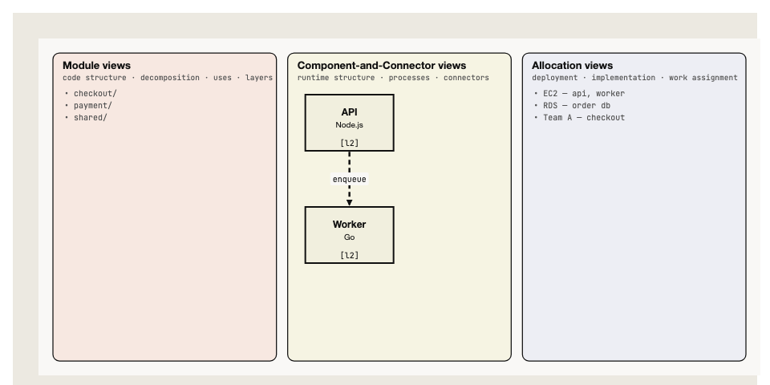

# KAN-082.5-WPS4DX 검토 요청 — viz SEI Views and Beyond 프레임 — Module·C&C·Allocation 세 뷰 슬롯

카드: [KAN-082.5-WPS4DX.md](../cards/KAN-082.5-WPS4DX.md)

> 이 문서는 **검토를 위해 만든 문서**다. 수행 내역은 카드 실행 문서에 있고, 시작 전
> 계획은 배치 문서에 있다. 여기 있는 것은 "지금 이 브랜치를 무엇으로 판정하는가" 뿐이다.

## 1. 검토 대상

| 항목 | 값 |
|---|---|
| 브랜치 | `KAN-082-MD50S0` |
| 워크트리 | `/Users/centurio/orca/workspaces/bbangto-ui/KAN-082-MD50S0` |
| 베이스 | `64dc999` |
| 변경 훑기 | `git diff 64dc999...HEAD` |

**커밋 1건**

```text
da5a38f feat(visualization): ViewsAndBeyondFrame — SEI Module · C&C · Allocation 세 뷰 조합 프레임 (KAN-082 S15)
```

**변경 파일 10개 (+279 −8)**

| 파일 | 상태 | 추가 | 삭제 |
|---|:--:|---:|---:|
| `.changeset/kan-082-views-and-beyond.md` | M | 10 | 0 |
| `apps/storybook/src/stories/visualization/G6MetaFrames.stories.tsx` | M | 55 | 0 |
| `apps/storybook/src/stories/visualization/_paintGateFixtures.tsx` | M | 15 | 0 |
| `packages/foundations/src/vizPaintGateCoverage.test.ts` | M | 2 | 2 |
| `packages/visualization/README.md` | M | 3 | 0 |
| `packages/visualization/src/templates/ViewsAndBeyondFrame.tsx` | M | 140 | 0 |
| `packages/visualization/src/templates/index.ts` | M | 2 | 0 |
| `packages/visualization/src/templates/viewsAndBeyond.test.tsx` | M | 46 | 0 |
| `packages/visualization/src/typeMeta/registry.test.ts` | M | 5 | 5 |
| `packages/visualization/visualization-type-inventory.md` | M | 1 | 1 |

**롤백 태그 23개**

```text
kan/KAN-082-MD50S0/S1
kan/KAN-082-MD50S0/S10
kan/KAN-082-MD50S0/S11
kan/KAN-082-MD50S0/S12
kan/KAN-082-MD50S0/S13
kan/KAN-082-MD50S0/S14
kan/KAN-082-MD50S0/S17
kan/KAN-082-MD50S0/S18
kan/KAN-082-MD50S0/S19
kan/KAN-082-MD50S0/S2
kan/KAN-082-MD50S0/S3
kan/KAN-082-MD50S0/S4
kan/KAN-082-MD50S0/S5
kan/KAN-082-MD50S0/S6
kan/KAN-082-MD50S0/S7
kan/KAN-082-MD50S0/S8
kan/KAN-082-MD50S0/S9
kan/KAN-082-MD50S0/batch1
kan/KAN-082-MD50S0/batch2
kan/KAN-082-MD50S0/batch3
kan/KAN-082-MD50S0/batch4
kan/KAN-082-MD50S0/batch5
kan/KAN-082-MD50S0/batch7
```

## 2. 검증 — 기준과 실행 결과

<!-- 기준은 카드 실행 문서 「검증」 절의 사본이다. 원본은 KANBAN/cards/KAN-082.5-WPS4DX.md 이므로
     기준이 바뀌면 그쪽을 고치고 review-init --refresh 로 이 항만 다시 만든다.
     결과는 작업한 쪽이 이미 돌린 것이다 — 검토자에게 다시 돌리라고 시키지 않는다.
     **다시 돌려 아래와 다르게 나오면 그 자체가 반려할 이유다.** -->

**기준**

- 프레임 시험(vitest): `packages/visualization/src/templates/viewsAndBeyond.test.tsx` — 세 영역 · 슬롯 우선 · 불릿 폴백 · 가로로 나란함.
- 유형 축 시험: `registry.test.ts`(allowlist 4 · 스캔 94 · 덮인 export 90).
- Storybook play: `Templates/G6-MetaFrames` ViewsAndBeyondSEI, Paint Gate 표본.
- 품질 게이트 다섯이 초록이다: `pnpm typecheck` · `pnpm build` · `pnpm test` · `pnpm --filter storybook build` · `pnpm test:unit`.

**실행 결과**

```text
게이트 다섯 (2026-11-25, 워크트리 KAN-082-MD50S0, 커밋 da5a38f 시점)
pnpm typecheck → rc=0 · pnpm build → rc=0(번들 23, 2.98초 — 그 앞 두 번은 build 직후 부하로 측정기 자체 시험이 5초 제한에 걸림, 단독 2.6~2.8초 통과)
pnpm test → rc=0 · Test Files 199 · Tests 1326 · pnpm --filter storybook build → rc=0
pnpm test:unit → rc=0 · visualization 471 · foundations 143 · hooks 115 · style-guide-catalog 116 · viz catalog 85
viewsAndBeyond.test.tsx 4 건(구현 전 빨강) · registry allowlist 4 통과 · a11y(G6MetaFrames test:'error' 임시 강제) 위반 0
```

## 3. 판단 항목 — 스크립트가 판정할 수 없는 것

<!-- 스크립트가 판정할 수 없는 것만 적는다 — 값의 진위, 선택지 중 하나를 고른 근거,
     범위를 정한 기준. 2항에서 이미 돌아간 검증을 여기 옮겨 적지 않는다.
     한 줄 형식: 체크박스 하나에 의견 하나 — "<주제> — <지금 고른 값과 그 근거>".
     **의견마다 상세가 따라붙고, 상세는 조각 둘이다** — `**배경**` 과 `**정할 것**` 이
     각각 단독 줄이다(없거나 하나뿐이면 종료코드 12). 검토자는 이 카드를 수행하지
     않았으므로 내부 기호(`L10`·`P5`·`S8`)만 던지면 판정할 재료가 없고, 재료가 있어도
     줄글 한 덩이면 필요한 부분만 골라 읽지 못한다.
       **보기** — 그림이 설명보다 먼저다. `- 종류: 동작|설계|결과물` 과 `- `, 그릴 것이
         없으면 `- 종류: 없음 — <이유>`. 그림은 `review-attach` 로 붙인다(SKILL.md 5.6).
       **배경** — 무엇이 문제인가. `- ` 목록으로, 항목 하나에 사실 하나. 기호를 풀어 쓰고
         항목 끝에 `원문: 파일:줄` 이나 링크를 건다. ①②… 로 늘어놓을 것은 항목으로 가른다.
         목록이 없으면 종료코드 12 — 줄글은 화면에서 한 문단으로 붙는다.
       **정할 것** — 정할 것 한 줄. 그 아래 갈래마다 대가와 결과를 표로 단다:
         | 선택지 | 대가 | 그러면 어떻게 되는가 |
       추천은 선택지 셀 맨 앞의 `**추천** ` 접두다. 「~가 맞는가」로만 묻더라도 아니라고 답할 때
         갈 길(고친다 · 뺀다 · 미룬다)이 있으면 그 길을 갈래로 적는다 — 화면에서 표 없는 항목은
         「승인」 · 「직접 적기」 둘뿐이다. 정말 동의만 구하는 항목이면 표를 비운다.
     **말투와 낱말(SKILL.md 5.10).** 주제 · 배경 · 정할 것은 존댓말(합쇼체 — 「~합니다」 ·
     「~할까요?」)로 쓰고, 이 스킬 안에서만 통하는 낱말과 잘 쓰이지 않는 한자어를 쓰지 않는다 — 목록은 manage-kanban 의
     assets/writing/words.md 이고, 쓰면 경고가 뜬다. 여러 낱말로 된 약속된 용어(「기획 결정」 등)는
     「」로 감싸 앞뒤 글과 구분한다.
     **올리기 전에 둘을 본다.** ① 이 의견이 카드 의도(원문·목적·이유·목표)와 이어지는가
     — 이어지지 않으면 올리지 않는다. 문제를 위한 문제는 판단 항목이 아니라 별도 카드다.
     ② 지시 원본보다 낮은 레이어로 내려가지 않았는가 — 유저가 제품 관점으로 지시했는데
     플래그 이름·함수 이름을 묻고 있으면 서술을 고칠 것이 아니라 올릴 것이 아니다.
     (SKILL.md 5.6 「판단 항목에 무엇을 올리는가」)
     비어 있으면 "기계가 다 판정했고 사람이 정할 것이 없다"는 뜻이다. 그 판단도
     작업한 쪽이 하는 것이지 검토자가 빈칸을 보고 추측할 일이 아니다.
     **넘겨받은 절(3-0, `--inherit`)이 있으면 그것이 먼저 온다** — 다른 검토서에서 넘어온 의견이고,
     판정은 그것을 넘겨받은 이 문서 하나에서만 내려진다. -->

**의견마다 선택지를 고르거나 추가 의견을 답니다.** 「정할 것」 표가 있으면 선택지 하나를 고르고, 표가 없으면
그 의견을 승인합니다. 고른 순간 그 항목은 승인이고, 마음에 드는 선택지가 없으면 추가 의견을 적습니다 —
그 항목은 열린 채 남습니다. 의견 하나만 먼저 고를 수도 있습니다. 검토 화면에서는 「제출」 한 번으로 보냅니다.
`<번호>`는 의견 순서이고, 주제의 문구 일부로도 찾습니다.

```
# 고르기 — 갈래 번호(1부터)나 이름. 표가 없는 항목은 --choice 없이(그 의견의 승인)
python3 scripts/kanban.py review-choose <project-root> --card KAN-082.5-WPS4DX --item <번호> --choice <번호|이름>
# 추가 의견
python3 scripts/kanban.py review-note <project-root> --card KAN-082.5-WPS4DX --item <번호> --text "<추가 의견>"
# 반려 · 철회 — 화면에는 없고 명령에만 있습니다
python3 scripts/kanban.py review-judge <project-root> --card KAN-082.5-WPS4DX --item <번호> --verdict 반려|철회
# 추가 의견을 반영하다 새 의견이 생겼으면 (맨 뒤에 붙어 앞 번호가 안 밀립니다)
python3 scripts/kanban.py review-item <project-root> --card KAN-082.5-WPS4DX --add "<주제>
  <상세>"
```

**전체 승인은 살아있는 항목이 전부 승인일 때만 섭니다**(철회는 분모에서 빠집니다). 하나라도
반려·추가 의견·미정이면 4항의 전체 승인도 `→ 완료` 이동도 종료코드 14로 거부됩니다.

- [ ] SEI Views and Beyond 프레임의 영역 이름을 영어로 두었는데 이대로 둘까요 — Kruchten 4+1 프레임과 같은 방식입니다
    - **보기**
      - 종류: 동작
      - 
    - **배경**
      - 원문은 SEI Views and Beyond 가 모든 뷰를 Module(코드 구조) · C&C(런타임 구조) · Allocation(물리 배치 · 팀 배치) 셋으로 나눈다고 적습니다. 원문: KANBAN.md 의 KAN-082-MD50S0 카드 원문 블록
      - 이미 있는 아키텍처 뷰 프레임(Kruchten 4+1)은 영역 이름과 부제를 영어로 그립니다. 새 프레임도 같게 했습니다. 원문: packages/visualization/src/templates/Kruchten4Plus1View.tsx:39
      - 영역 이름은 지금 데이터로 바꿀 수 없습니다. 슬롯과 불릿만 데이터로 받습니다.
    - **정할 것**
      영역 이름을 어떻게 둘까요?

    | 선택지 | 대가 | 그러면 어떻게 되는가 |
    | --- | --- | --- |
    | **추천** 영어 그대로 둔다 | 한국어 문서 안에서는 영역 이름만 영어입니다 | 두 프레임이 같은 방식이고, 원래 용어 그대로입니다 |
    | 영역 이름 · 부제를 데이터로 바꿀 수 있게 연다 | 두 프레임 모두 칸이 하나씩 늘어납니다 | 문서 언어에 맞춰 이름을 바꿀 수 있습니다 |

    > **판정** — _아직 없습니다._

    > **추가 의견** — _아직 없습니다._


## 4. 판정

<!-- 문서 하나에 대한 판정이다. **항목별로 갈리는 말은 여기 적지 않는다** — 3항 각 의견의
     「판정」과 「추가 의견」에 적는다. 여기 남는 것은 그 항목들이 전부 승인으로 닫혔다는
     사실 하나뿐이다.
     아래 「판정 이력」은 **덧붙기만 하는 이력**이다. 왕복이 돌면 줄이 쌓이고, 그것이 이 문서가
     무엇을 거쳐 승인에 닿았는지의 전부다 — 지우지 않는다. **판정에는 이유를 적는 칸이 없다** —
     승인은 대체로 덧붙일 말이 없고, 있다면 그것은 문서 전체가 아니라 그 항목에 대한
     말이라 3항의 「추가 의견」이 받는다.
     `review-judge --card KAN-082.5-WPS4DX --verdict 승인` 이 이 판정을 적고
     frontmatter 의 status 도 함께 고친다. 손으로 적어도 되지만, 그때는 수렴 검사를
     안 거치므로 `validate` 가 항목 판정과 어긋난 승인을 error 로 잡는다. -->

**판정**: (아직 없습니다)

**판정 이력**:

- 승인이면 → `apply --op move --id KAN-082.5-WPS4DX --to done` 뒤에 `main` 병합과 워크트리 정리(출력의 `cleanup`)
- 반려면 → `apply --op move --id KAN-082.5-WPS4DX --to doing` 뒤에 `doc-log --entry "<반려 이유>"`.
  검토서는 **지우지도 새로 만들지도 않습니다** — 고친 뒤 그 항목을 `review-judge --verdict 승인` 으로
  바꾸면 같은 문서에서 모든 항목이 승인될 때까지 이어 갑니다. 1·2항이 최신이 아니면 `review-init --refresh` 로 그 두 항만 새로 씁니다.
