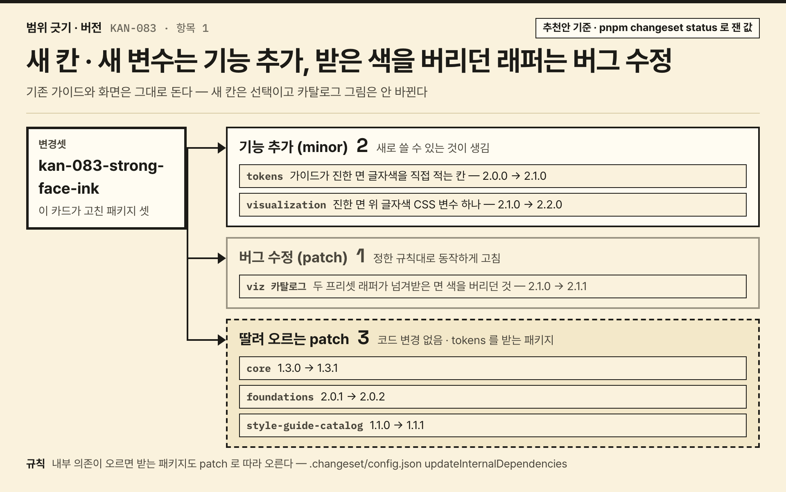
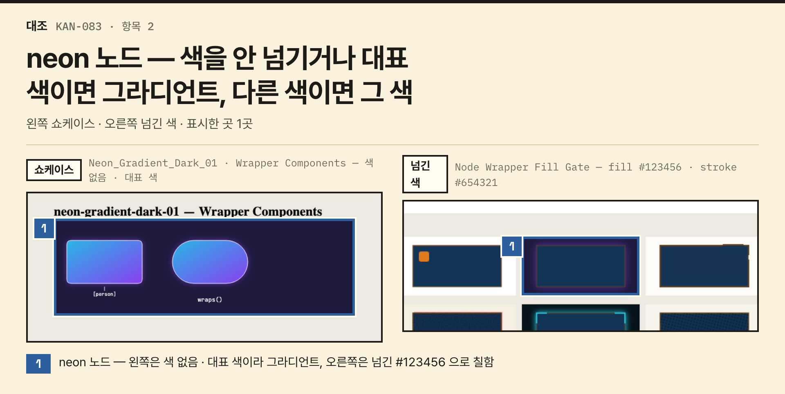
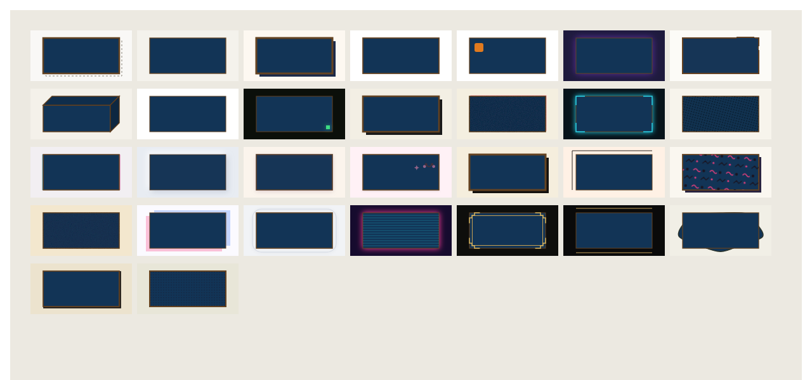
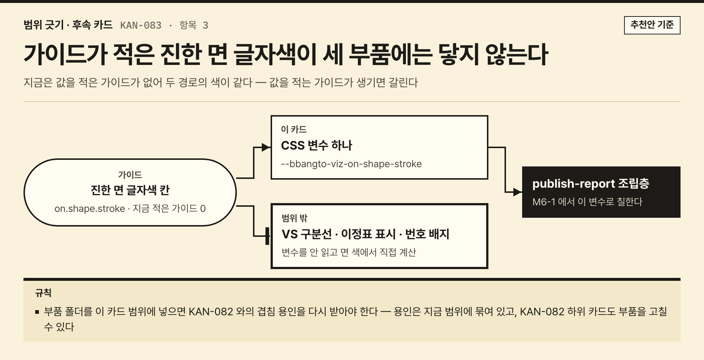
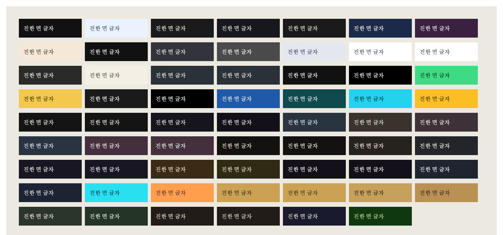

# KAN-083-JSQKF4 검토 요청 — viz 진한 면 위 글자색 변수와 terminal-ascii Node 래퍼의 면 색 따르기 — publish-report 조립층을 bbangto 계약으로 칠하기 위한 확장

카드: [KAN-083-JSQKF4.md](../cards/KAN-083-JSQKF4.md)

> 이 문서는 **검토를 위해 만든 문서**다. 수행 내역은 카드 실행 문서에 있고, 시작 전
> 계획은 배치 문서에 있다. 여기 있는 것은 "지금 이 브랜치를 무엇으로 판정하는가" 뿐이다.

## 1. 검토 대상

| 항목 | 값 |
|---|---|
| 브랜치 | `KAN-083-JSQKF4` |
| 워크트리 | `/Users/centurio/orca/workspaces/bbangto-ui/KAN-083-JSQKF4` |
| 베이스 | `9e1d345` |
| 변경 훑기 | `git diff 9e1d345...HEAD` |

**커밋 7건**

```text
8a5221b kanban: KAN-083-JSQKF4 검증 절을 실제 시험 이름 · 체크리스트 줄로 고침
cfd1f8e kanban: KAN-083-JSQKF4 검토 이동 전 멈춤 기록
56e0f1c chore: 변경셋 kan-083 · neon 대표 hex 를 그라디언트 요청으로 · 게이트 다섯 통과 (KAN-083 S4)
bd0133f fix(visualization-style-guide-catalog): terminal-ascii · neon-gradient-dark Node 래퍼가 넘겨받은 fill 을 따른다 + 게이트 스토리 둘 (KAN-083 S3)
b902c5b feat(visualization): 진한 면(shape.stroke) 위 글자색 --bbangto-viz-on-shape-stroke · tokens on.shape.stroke 칸 (KAN-083 S2)
102c0ec test(visualization): 진한 면(shape.stroke) 위 글자색 on 변수 시험 — 구현 전 실패 (KAN-083 S1)
0ce18aa kanban: KAN-083-JSQKF4 진행 중으로 이동
```

**변경 파일 16개 (+243 −38)**

| 파일 | 상태 | 추가 | 삭제 |
|---|:--:|---:|---:|
| `.changeset/kan-083-strong-face-ink.md` | M | 13 | 0 |
| `.kanban/archive.jsonl` | M | 1 | 0 |
| `.kanban/log.md` | M | 1 | 1 |
| `.kanban/state.json` | M | 12 | 12 |
| `KANBAN.board.html` | M | 2 | 2 |
| `KANBAN.md` | M | 3 | 3 |
| `KANBAN/cards/KAN-083-JSQKF4.md` | M | 22 | 6 |
| `apps/storybook/src/stories/visualization/NodeWrapperFillGate.stories.tsx` | M | 127 | 0 |
| `packages/tokens/src/visualization.ts` | M | 3 | 2 |
| `packages/visualization-style-guide-catalog/src/neonGradientDark.tsx` | M | 25 | 8 |
| `packages/visualization-style-guide-catalog/src/onInk.test.ts` | M | 2 | 0 |
| `packages/visualization-style-guide-catalog/src/terminalAscii.tsx` | M | 2 | 1 |
| `packages/visualization-style-guide-catalog/src/textInk.test.ts` | M | 1 | 0 |
| `packages/visualization/README.md` | M | 2 | 1 |
| `packages/visualization/src/tokens/onInk.test.ts` | M | 24 | 0 |
| `packages/visualization/src/tokens/onInk.ts` | M | 3 | 2 |

**롤백 태그 5개**

```text
kan/KAN-083-JSQKF4/S1
kan/KAN-083-JSQKF4/S2
kan/KAN-083-JSQKF4/S3
kan/KAN-083-JSQKF4/S4
kan/KAN-083-JSQKF4/batch1
```

## 2. 검증 — 기준과 실행 결과

<!-- 기준은 카드 실행 문서 「검증」 절의 사본이다. 원본은 KANBAN/cards/KAN-083-JSQKF4.md 이므로
     기준이 바뀌면 그쪽을 고치고 review-init --refresh 로 이 항만 다시 만든다.
     결과는 작업한 쪽이 이미 돌린 것이다 — 검토자에게 다시 돌리라고 시키지 않는다.
     **다시 돌려 아래와 다르게 나오면 그 자체가 반려할 이유다.** -->

**기준**

- `pnpm test:unit` — viz `src/tokens/onInk.test.ts`, 카탈로그 `src/onInk.test.ts` · `src/textInk.test.ts`(가이드 30종 × `shape.stroke` 면 4.5:1)가 통과한다
- `pnpm test` — Storybook `VISUALIZATION/Templates/Node Wrapper Fill Gate` 의 두 play 가 통과한다. 하나는 가이드 30종 Node 래퍼에 넘긴 fill · stroke 가 계산값으로 칠해지는지, 다른 하나는 preset 전부에서 진한 면 글자가 4.5:1 을 넘는지 잰다. 기존 시험 전부도 함께 통과한다
- `pnpm typecheck` · `pnpm build`(끝의 번들 크기 게이트 포함) · `pnpm --filter storybook build` 가 초록이다
- 고치기 전 커밋에서 S1 · S3 시험이 빨갛게 실패한 기록이 수행 내역에 있다
- `QUALITY_CHECKLIST.md` 의 B(컴포넌트 수정) · C(토큰/테마 변경) · E(Story 추가) 절을 채워 검토서 검증 절과 PR 본문에 붙인다

**실행 결과**

```text
게이트 다섯 — 2026-11-24 12:09~12:11 실행(scratchpad k83-gates/summary.txt). 코드는 커밋 56e0f1c 와 같고 그 뒤 커밋은 칸반 기록뿐입니다.
START typecheck 12:09:40
END typecheck exit=0 12:09:53
START build 12:09:53
END build exit=0 12:10:10
START test 12:10:10
END test exit=0 12:11:00
START sbbuild 12:11:00
END sbbuild exit=0 12:11:08
START unit 12:11:08
END unit exit=0 12:11:14
DONE

[pnpm build — 끝의 번들 크기 게이트]
 Test Files  1 passed (1)
      Tests  23 passed (23)
[pnpm test — Storybook · Playwright chromium]
 Test Files  198 passed (198)
      Tests  1314 passed (1314)
[pnpm --filter storybook build]
└  Storybook build completed successfully
[pnpm test:unit]
packages/hooks test:  Test Files  30 passed (30)
packages/hooks test:       Tests  115 passed (115)
packages/foundations test:  Test Files  10 passed (10)
packages/foundations test:       Tests  143 passed (143)
packages/visualization test:  Test Files  29 passed (29)
packages/visualization test:       Tests  304 passed (304)
packages/style-guide-catalog test:  Test Files  6 passed (6)
packages/style-guide-catalog test:       Tests  116 passed (116)
.../visualization-style-guide-catalog test:  Test Files  7 passed (7)
.../visualization-style-guide-catalog test:       Tests  85 passed (85)

[고치기 전 실패 — 카드 수행 내역]
S1 12:01 — viz 시험 3건 undefined, 카탈로그 가이드 전부 「변수 없음」으로 실패
S3 12:06 — terminal-ascii · neon-gradient-dark 가 넘긴 fill 을 버려 Node Wrapper Fill Gate 실패

[pnpm changeset status --verbose]
🦋  info Packages to be bumped at patch
🦋  - @centurio1987/bbangto-ui-visualization-style-guide-catalog 2.1.1
🦋    - .changeset/kan-083-strong-face-ink.md
🦋  - @centurio1987/bbangto-ui-core 1.3.1
🦋  - @centurio1987/bbangto-ui-foundations 2.0.2
🦋  - @centurio1987/bbangto-ui-style-guide-catalog 1.1.1
🦋  ---
🦋  info Packages to be bumped at minor
🦋  - @centurio1987/bbangto-ui-tokens 2.1.0
🦋    - .changeset/kan-083-strong-face-ink.md
🦋  - @centurio1987/bbangto-ui-visualization 2.2.0
🦋    - .changeset/kan-083-strong-face-ink.md
🦋  ---
🦋  info Running release would release NO packages as a major

[품질 체크리스트 — QUALITY_CHECKLIST.md B · C · E 절과 공통 금지 사항]
B. 컴포넌트 수정 (terminal-ascii · neon-gradient-dark Node 래퍼)
- [x] props API 그대로. fill 을 넘기지 않으면 DOM 도 같다. neon 에 대표 색이 아닌 fill 을 넘기면 그라디언트 defs 가 빠지고 그 색으로 칠한다(이 카드가 의도한 변경)
- [x] 영향받는 foundation 파일 — 해당 없음(값 변경 없음)
- [x] 기존 story · play 전부 통과(198 파일 1,314건), 의존 story(가이드 30종 Wrapper Components 쇼케이스) 포함
C. 토큰/테마 변경 (on.shape.stroke · --bbangto-viz-on-shape-stroke)
- [x] 타입 먼저 — S1 시험 뒤 S2 에서 tokens 타입과 구현
- [x] BbangtoFoundation 파일 전부 — 해당 없음. 바뀐 것은 시각화 가이드 타입의 선택 칸이고 typecheck 통과
- [x] 기존 컴포넌트 호환 — 선택 칸 · 변수 추가뿐
- [x] story play 의 CSS 변수 검증 — Strong Face Ink Gate 가 변수가 있는지와 4.5:1 을 잰다
E. Story 추가 (NodeWrapperFillGate.stories.tsx)
- [x] 위치 apps/storybook/src/stories/visualization/, 이름 Node Wrapper Fill Gate · Strong Face Ink Gate, play 포함. args 없음(렌더 전용 검사 화면)
- [ ] addon-a11y — 이 검사 화면은 a11y 시험을 끔. TemplatePaintGate.stories.tsx 와 같은 방식이고, 같은 모양 그림 30장이라 axe 로 더 알 것이 없다고 봄
공통 금지 사항
- [x] 하드코딩 색은 시험 입력값(#123456 · #654321)뿐, 컴포넌트 코드에는 없음
- [x] document · window 직접 접근 없음(play 의 getComputedStyle 만), 새 런타임 의존성 없음, any 없음
```

## 3. 판단 항목 — 스크립트가 판정할 수 없는 것

<!-- 스크립트가 판정할 수 없는 것만 적는다 — 값의 진위, 선택지 중 하나를 고른 근거,
     범위를 정한 기준. 2항에서 이미 돌아간 검증을 여기 옮겨 적지 않는다.
     한 줄 형식: 체크박스 하나에 의견 하나 — "<주제> — <지금 고른 값과 그 근거>".
     **의견마다 상세가 따라붙고, 상세는 조각 둘이다** — `**배경**` 과 `**정할 것**` 이
     각각 단독 줄이다(없거나 하나뿐이면 종료코드 12). 검토자는 이 카드를 수행하지
     않았으므로 내부 기호(`L10`·`P5`·`S8`)만 던지면 판정할 재료가 없고, 재료가 있어도
     줄글 한 덩이면 필요한 부분만 골라 읽지 못한다.
       **보기** — 그림이 설명보다 먼저다. `- 종류: 동작|설계|결과물` 과 `- `, 그릴 것이
         없으면 `- 종류: 없음 — <이유>`. 그림은 `review-attach` 로 붙인다(SKILL.md 5.6).
       **배경** — 무엇이 문제인가. `- ` 목록으로, 항목 하나에 사실 하나. 기호를 풀어 쓰고
         항목 끝에 `원문: 파일:줄` 이나 링크를 건다. ①②… 로 늘어놓을 것은 항목으로 가른다.
         목록이 없으면 종료코드 12 — 줄글은 화면에서 한 문단으로 붙는다.
       **정할 것** — 정할 것 한 줄. 그 아래 갈래마다 대가와 결과를 표로 단다:
         | 선택지 | 대가 | 그러면 어떻게 되는가 |
       추천은 선택지 셀 맨 앞의 `**추천** ` 접두다. 「~가 맞는가」로만 묻더라도 아니라고 답할 때
         갈 길(고친다 · 뺀다 · 미룬다)이 있으면 그 길을 갈래로 적는다 — 화면에서 표 없는 항목은
         「승인」 · 「직접 적기」 둘뿐이다. 정말 동의만 구하는 항목이면 표를 비운다.
     **말투와 낱말(SKILL.md 5.10).** 주제 · 배경 · 정할 것은 존댓말(합쇼체 — 「~합니다」 ·
     「~할까요?」)로 쓰고, 이 스킬 안에서만 통하는 낱말과 잘 쓰이지 않는 한자어를 쓰지 않는다 — 목록은 manage-kanban 의
     assets/writing/words.md 이고, 쓰면 경고가 뜬다. 여러 낱말로 된 약속된 용어(「기획 결정」 등)는
     「」로 감싸 앞뒤 글과 구분한다.
     **올리기 전에 둘을 본다.** ① 이 의견이 카드 의도(원문·목적·이유·목표)와 이어지는가
     — 이어지지 않으면 올리지 않는다. 문제를 위한 문제는 판단 항목이 아니라 별도 카드다.
     ② 지시 원본보다 낮은 레이어로 내려가지 않았는가 — 유저가 제품 관점으로 지시했는데
     플래그 이름·함수 이름을 묻고 있으면 서술을 고칠 것이 아니라 올릴 것이 아니다.
     (SKILL.md 5.6 「판단 항목에 무엇을 올리는가」)
     비어 있으면 "기계가 다 판정했고 사람이 정할 것이 없다"는 뜻이다. 그 판단도
     작업한 쪽이 하는 것이지 검토자가 빈칸을 보고 추측할 일이 아니다.
     **넘겨받은 절(3-0, `--inherit`)이 있으면 그것이 먼저 온다** — 다른 검토서에서 넘어온 의견이고,
     판정은 그것을 넘겨받은 이 문서 하나에서만 내려진다. -->

**의견마다 선택지를 고르거나 추가 의견을 답니다.** 「정할 것」 표가 있으면 선택지 하나를 고르고, 표가 없으면
그 의견을 승인합니다. 고른 순간 그 항목은 승인이고, 마음에 드는 선택지가 없으면 추가 의견을 적습니다 —
그 항목은 열린 채 남습니다. 의견 하나만 먼저 고를 수도 있습니다. 검토 화면에서는 「제출」 한 번으로 보냅니다.
`<번호>`는 의견 순서이고, 주제의 문구 일부로도 찾습니다.

```
# 고르기 — 갈래 번호(1부터)나 이름. 표가 없는 항목은 --choice 없이(그 의견의 승인)
python3 scripts/kanban.py review-choose <project-root> --card KAN-083-JSQKF4 --item <번호> --choice <번호|이름>
# 추가 의견
python3 scripts/kanban.py review-note <project-root> --card KAN-083-JSQKF4 --item <번호> --text "<추가 의견>"
# 반려 · 철회 — 화면에는 없고 명령에만 있습니다
python3 scripts/kanban.py review-judge <project-root> --card KAN-083-JSQKF4 --item <번호> --verdict 반려|철회
# 추가 의견을 반영하다 새 의견이 생겼으면 (맨 뒤에 붙어 앞 번호가 안 밀립니다)
python3 scripts/kanban.py review-item <project-root> --card KAN-083-JSQKF4 --add "<주제>
  <상세>"
```

**전체 승인은 살아있는 항목이 전부 승인일 때만 섭니다**(철회는 분모에서 빠집니다). 하나라도
반려·추가 의견·미정이면 4항의 전체 승인도 `→ 완료` 이동도 종료코드 14로 거부됩니다.

- [ ] 새 버전을 tokens · visualization 은 기능 추가(minor), 시각화 카탈로그는 버그 수정(patch)으로 낼까요 — 새 칸과 새 변수는 기능 추가이고, 넘겨받은 색을 버리던 것은 버그라서입니다
    - **보기**
      - 종류: 설계
      - 
    - **배경**
      - 이 카드는 publish-report 가 자체 색칠을 멈추고 bbangto-ui 의 색 규칙으로 칠할 수 있도록, bbangto-ui 에 없던 표현 둘을 더했습니다. 원문: ~/.claude/plans/publish-report-skill.md (2026-11-24 절)
      - tokens 에는 가이드가 진한 면 위 글자색을 직접 적는 칸이 생겼습니다. 선택 칸이라 지금 가이드는 고치지 않아도 그대로 돕니다. 원문: packages/tokens/src/visualization.ts:141
      - visualization 은 그 글자색을 CSS 변수 하나로 냅니다. 원문: packages/visualization/src/tokens/onInk.ts:114
      - 시각화 카탈로그는 두 프리셋(terminal-ascii · neon-gradient-dark)이 넘겨받은 면 색을 버리던 것을 고쳤습니다. 원문: packages/visualization-style-guide-catalog/src/terminalAscii.tsx:195
      - 배포하면 코드 변경이 없는 core · foundations · style-guide-catalog 도 patch 로 함께 오릅니다. tokens 를 받는 패키지라 저장소 설정이 그렇게 정해 둡니다. 원문: .changeset/config.json:9
    - **정할 것**
      버전을 어떻게 올릴까요?

    | 선택지 | 대가 | 그러면 어떻게 되는가 |
    | --- | --- | --- |
    | **추천** tokens · visualization minor, 시각화 카탈로그 patch | 버전 숫자가 패키지마다 다르게 오릅니다 | 받는 쪽이 새로 쓸 수 있는 것이 생겼다는 것을 버전 숫자로 알아봅니다 |
    | 셋 다 patch | 새 칸과 새 변수가 버그 수정처럼 보입니다 | 새 변수가 있는 버전을 받는 범위(^2.2.0)로 고르지 못하고 끝자리까지 맞춰야 합니다 |

    > **판정** — _아직 없습니다._

    > **추가 의견** — _아직 없습니다._

- [ ] neon-gradient-dark 노드는 넘겨받은 색이 대표 색이 아니면 그 색으로 칠할까요 — 지금 그렇게 고쳤고, 카탈로그 그림은 바뀌지 않았습니다
    - **보기**
      - 종류: 결과물
      - 
      - 
    - **배경**
      - neon-gradient-dark 는 노드를 늘 그라디언트로 칠하고 넘겨받은 면 색을 버렸습니다. bbangto-ui 구현 규칙의 「명시한 색이 이긴다」와 맞지 않았습니다. 원문: packages/visualization/README.md:250
      - 그래서 publish-report 처럼 칸마다 색을 골라 칠하는 쪽은 이 프리셋에서 사각형을 한 겹 덧칠해야 했고, 덧칠은 프리셋 모양을 덮습니다. 원문: ~/.claude/skills/publish-report/engine/compose/parts.tsx
      - 이제 색을 넘기지 않거나 노드 종류의 면이나 가이드 대표 색을 넘기면 그라디언트를 그대로 그리고, 그 밖의 색을 넘기면 그 색으로 칠합니다. 원문: packages/visualization-style-guide-catalog/src/neonGradientDark.tsx:218
      - 카탈로그 쇼케이스는 색을 안 넘기거나 대표 색만 넘기므로 그림이 바뀌지 않습니다. 기존 Storybook 시험 1,314건이 그대로 통과했습니다. 원문: apps/storybook/src/stories/_vizCatalogStory.tsx:211
      - 처음 고쳤을 때는 대표 색도 보통 색으로 보아 쇼케이스 시험 하나가 깨졌습니다. 대표 색을 그라디언트 요청으로 보게 고쳐 다시 통과시켰습니다. 원문: KANBAN/cards/KAN-083-JSQKF4.md (수행 내역 12:11)
    - **정할 것**
      neon 노드에 다른 색을 넘기면 어떻게 칠할까요?

    | 선택지 | 대가 | 그러면 어떻게 되는가 |
    | --- | --- | --- |
    | **추천** 넘긴 색을 따른다(지금) | 색을 넘긴 노드에서는 neon 다운 그라디언트가 빠집니다 | 덧칠이 없어지고 가이드 30종 노드가 같은 규칙으로 칠해집니다 |
    | 늘 그라디언트로 되돌린다 | neon 만 규칙 밖에 남아 새 시험에서 예외로 빼야 합니다 | publish-report 는 neon 에서만 덧칠을 계속합니다 |
    | 넘긴 색으로 그라디언트를 만든다 | 색 하나에서 그라디언트 두 끝을 정하는 규칙을 새로 세워야 해 이 카드 범위를 넘습니다 | 별도 카드로 올려 설계합니다 |

    > **판정** — _아직 없습니다._

    > **추가 의견** — _아직 없습니다._

- [ ] 가이드가 적은 진한 면 글자색이 세 부품(VS 구분선 · 이정표 표시 · 번호 배지)에는 닿지 않습니다 — 별도 카드로 고칠까요
    - **보기**
      - 종류: 설계
      - 
    - **배경**
      - 이 카드로 각 테마(가이드)가 진한 면 위 글자색을 직접 정할 수 있게 됐습니다. 지시 「테마별 구분도 있어야 한다」를 받은 칸입니다. 원문: packages/tokens/src/visualization.ts:141
      - VS 구분선 · 이정표 표시 · 번호 배지는 그 글자색을 새 변수에서 읽지 않고 면 색에서 직접 계산합니다. 원문: packages/visualization/src/atoms/VsDivider.tsx:21 · MilestoneMarker.tsx:25 · IndexBadge.tsx:26
      - 계산 방법이 같아서 지금은 색이 같습니다. 아직 값을 적은 가이드가 없기 때문이고, 값을 적는 가이드가 생기면 세 부품만 다른 색이 됩니다. 원문: packages/visualization/src/tokens/onInk.ts:107
      - 세 부품의 폴더를 이 카드 범위에 넣으면 KAN-082(시각화 도식 표현력 확장) 카드와의 범위 겹침 용인을 다시 받아야 합니다. 용인은 지금 범위에 묶여 있습니다. 원문: .kanban/state.json (waivers 의 KAN-082 · KAN-083 쌍)
    - **정할 것**
      세 부품을 어떻게 할까요?

    | 선택지 | 대가 | 그러면 어떻게 되는가 |
    | --- | --- | --- |
    | **추천** 별도 카드로 할 일에 올린다 | 그 카드가 끝날 때까지 가이드가 적은 값이 세 부품에 닿지 않습니다 | 이 카드는 지금 범위로 닫히고 publish-report 쪽 작업이 기다리지 않습니다 |
    | 이 카드에서 함께 고친다 | 범위가 바뀌어 겹침 용인을 다시 받고 검토를 한 번 더 돌립니다 | 배포가 그만큼 늦어집니다 |
    | 그대로 둔다 | 값을 적는 가이드가 생기면 세 부품만 글자색이 다릅니다 | 테마별 글자색이 부품마다 갈릴 수 있습니다 |

    > **판정** — _아직 없습니다._

    > **추가 의견** — _아직 없습니다._

- [ ] 진한 면 위 글자색은 계산값을 그대로 쓸까요 — 가이드 30종의 프리셋까지 62개 조합 모두 대비 4.5:1 을 넘습니다
    - **보기**
      - 종류: 동작
      - 
    - **배경**
      - publish-report 는 진한 칸의 글자를 바탕색으로 칠하고 대비를 스킬 안에서 따로 쟀습니다. 이제 그 글자는 bbangto-ui 가 내는 변수 하나로 칠합니다. 원문: ~/.claude/plans/publish-report-skill.md (2026-11-24 절)
      - 글자색은 다른 면과 같은 규칙으로 고릅니다. 가이드가 이 면에 적은 값, 가이드 공통 글자색, 가이드 색 넷, 검정 · 흰색 순으로 보고 4.5:1 을 넘는 첫 색을 씁니다. 원문: packages/visualization/src/tokens/onInk.ts:88
      - 브라우저가 실제로 계산한 색으로 62개 조합을 모두 재서 통과했습니다. 원문: apps/storybook/src/stories/visualization/NodeWrapperFillGate.stories.tsx:87
      - 지금은 어느 가이드도 이 면에 값을 적지 않았습니다. 테마마다 글자색이 다른 것은 면 색이 달라서입니다.
    - **정할 것**
      가이드마다 글자색을 따로 적을까요?

    | 선택지 | 대가 | 그러면 어떻게 되는가 |
    | --- | --- | --- |
    | **추천** 계산값을 쓴다 | 테마마다 글자색이 다른 까닭이 면 색뿐입니다 | 새 가이드도 따로 할 일 없이 4.5:1 을 넘고, 값은 필요한 가이드가 그때 적습니다 |
    | 지금 가이드마다 값을 적는다 | 30종마다 색을 골라야 하고 이 카드 범위가 카탈로그 가이드 파일 전부로 넓어집니다 | 테마 성격에 맞춘 글자색을 지금 고를 수 있습니다 |

    > **판정** — _아직 없습니다._

    > **추가 의견** — _아직 없습니다._


## 4. 판정

<!-- 문서 하나에 대한 판정이다. **항목별로 갈리는 말은 여기 적지 않는다** — 3항 각 의견의
     「판정」과 「추가 의견」에 적는다. 여기 남는 것은 그 항목들이 전부 승인으로 닫혔다는
     사실 하나뿐이다.
     아래 「판정 이력」은 **덧붙기만 하는 이력**이다. 왕복이 돌면 줄이 쌓이고, 그것이 이 문서가
     무엇을 거쳐 승인에 닿았는지의 전부다 — 지우지 않는다. **판정에는 이유를 적는 칸이 없다** —
     승인은 대체로 덧붙일 말이 없고, 있다면 그것은 문서 전체가 아니라 그 항목에 대한
     말이라 3항의 「추가 의견」이 받는다.
     `review-judge --card KAN-083-JSQKF4 --verdict 승인` 이 이 판정을 적고
     frontmatter 의 status 도 함께 고친다. 손으로 적어도 되지만, 그때는 수렴 검사를
     안 거치므로 `validate` 가 항목 판정과 어긋난 승인을 error 로 잡는다. -->

**판정**: (아직 없습니다)

**판정 이력**:

- 승인이면 → `apply --op move --id KAN-083-JSQKF4 --to done` 뒤에 `main` 병합과 워크트리 정리(출력의 `cleanup`)
- 반려면 → `apply --op move --id KAN-083-JSQKF4 --to doing` 뒤에 `doc-log --entry "<반려 이유>"`.
  검토서는 **지우지도 새로 만들지도 않습니다** — 고친 뒤 그 항목을 `review-judge --verdict 승인` 으로
  바꾸면 같은 문서에서 모든 항목이 승인될 때까지 이어 갑니다. 1·2항이 최신이 아니면 `review-init --refresh` 로 그 두 항만 새로 씁니다.
